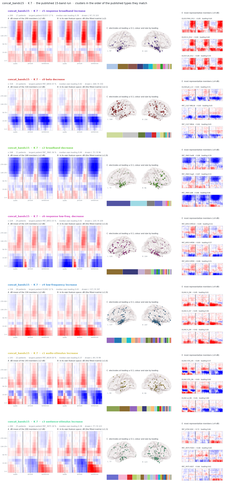
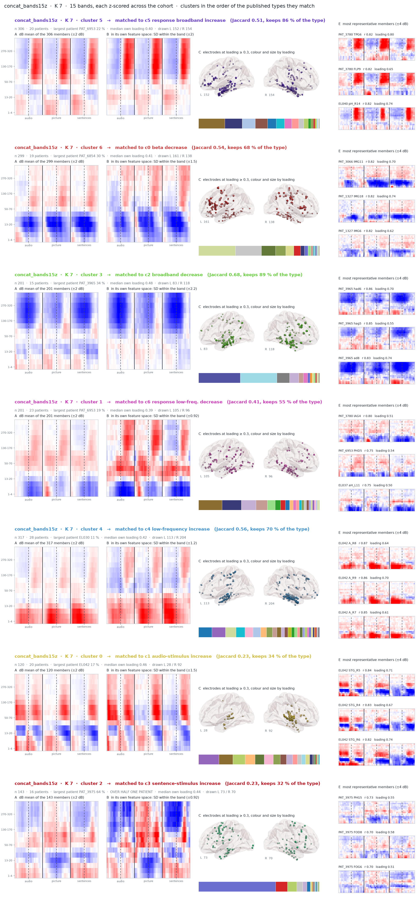
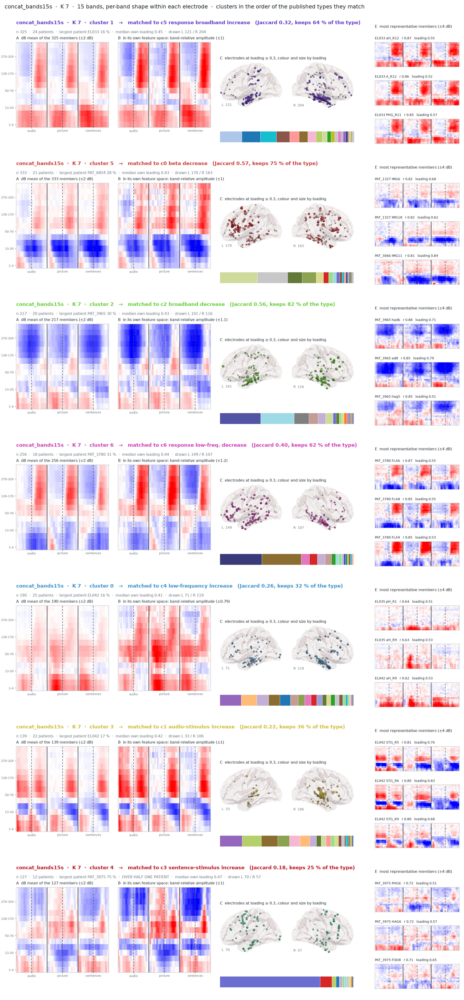
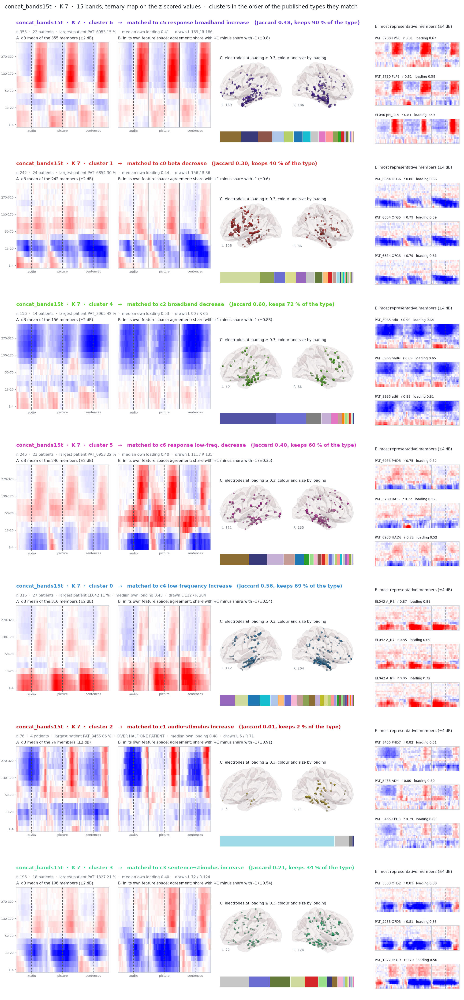

# Cluster cards on cache concat_source_v17

*Built 2026-11-08 00:46. One card per cluster; a variant cluster carries the colour of the published type it is matched to.*

| set | K | pos | cluster | matched type | Jaccard | keeps | n | patients | largest patient | share | median own loading | representatives |
|---|---|---|---|---|---|---|---|---|---|---|---|---|
| concat_bands15 | 7 | 1 | 5 | c5 response broadband increase | 1.00 | 100 % | 200 | 17 | EL033 | 17 % | 0.39 | EL033 PHG_R12, EL033 A_R12, EL033 aH_R12 |
| concat_bands15 | 7 | 2 | 0 | c0 beta decrease | 1.00 | 100 % | 318 | 22 | PAT_6854 | 25 % | 0.42 | EL038 pH_L13, PAT_1327 IMG18, PAT_1327 IMG6 |
| concat_bands15 | 7 | 3 | 2 | c2 broadband decrease | 1.00 | 100 % | 168 | 11 | PAT_3965 | 36 % | 0.44 | PAT_3965 had6, PAT_3965 hag5, PAT_3965 ad8 |
| concat_bands15 | 7 | 4 | 6 | c6 response low-freq. decrease | 1.00 | 100 % | 224 | 24 | PAT_6953 | 25 % | 0.42 | PAT_6953 HPD10, PAT_6953 HPD8, PAT_6953 HPD9 |
| concat_bands15 | 7 | 5 | 4 | c4 low-frequency increase | 1.00 | 100 % | 334 | 28 | EL042 | 12 % | 0.43 | EL042 A_R8, EL042 A_R7, EL042 A_R9 |
| concat_bands15 | 7 | 6 | 1 | c1 audio-stimulus increase | 1.00 | 100 % | 143 | 22 | PAT_6619 | 20 % | 0.37 | EL042 STG_R5, EL042 STG_R6, EL042 aI_R8 |
| concat_bands15 | 7 | 7 | 3 | c3 sentence-stimulus increase | 1.00 | 100 % | 200 | 25 | PAT_3975 | 18 % | 0.38 | PAT_6704 AD4, PAT_3975 FOD3, PAT_3975 IAD7 |
| concat_bands15z | 7 | 1 | 5 | c5 response broadband increase | 0.51 | 86 % | 306 | 20 | PAT_6953 | 22 % | 0.40 | PAT_3780 TPG6, PAT_3780 FLP9, EL040 pH_R14 |
| concat_bands15z | 7 | 2 | 6 | c0 beta decrease | 0.54 | 68 % | 299 | 19 | PAT_6854 | 30 % | 0.41 | PAT_3066 IMG11, PAT_1327 IMG18, PAT_1327 IMG6 |
| concat_bands15z | 7 | 3 | 3 | c2 broadband decrease | 0.68 | 89 % | 201 | 15 | PAT_3965 | 34 % | 0.48 | PAT_3965 had6, PAT_3965 hag5, PAT_3965 ad8 |
| concat_bands15z | 7 | 4 | 1 | c6 response low-freq. decrease | 0.41 | 55 % | 201 | 23 | PAT_6953 | 19 % | 0.39 | PAT_3780 IAG4, PAT_6953 PHD5, EL037 aH_L11 |
| concat_bands15z | 7 | 5 | 4 | c4 low-frequency increase | 0.56 | 70 % | 317 | 28 | EL030 | 11 % | 0.42 | EL042 A_R8, EL042 A_R9, EL042 A_R7 |
| concat_bands15z | 7 | 6 | 0 | c1 audio-stimulus increase | 0.23 | 34 % | 120 | 20 | EL042 | 17 % | 0.46 | EL042 STG_R5, EL042 STG_R4, EL042 STG_R6 |
| concat_bands15z | 7 | 7 | 2 | c3 sentence-stimulus increase | 0.23 | 32 % | 143 | 16 | PAT_3975 | 64 % | 0.44 | PAT_3975 PHG5, PAT_3975 FOD8, PAT_3975 FOG6 |
| concat_bands15s | 7 | 1 | 1 | c5 response broadband increase | 0.32 | 64 % | 325 | 24 | EL033 | 16 % | 0.45 | EL033 aH_R12, EL033 A_R12, EL033 PHG_R11 |
| concat_bands15s | 7 | 2 | 5 | c0 beta decrease | 0.57 | 75 % | 333 | 21 | PAT_6854 | 28 % | 0.43 | PAT_1327 IMG6, PAT_1327 IMG18, PAT_3066 IMG11 |
| concat_bands15s | 7 | 3 | 2 | c2 broadband decrease | 0.56 | 82 % | 217 | 20 | PAT_3965 | 30 % | 0.43 | PAT_3965 had6, PAT_3965 ad8, PAT_3965 hag5 |
| concat_bands15s | 7 | 4 | 6 | c6 response low-freq. decrease | 0.40 | 62 % | 256 | 18 | PAT_3780 | 31 % | 0.44 | PAT_3780 FLA6, PAT_3780 FLA8, PAT_3780 FLA9 |
| concat_bands15s | 7 | 5 | 0 | c4 low-frequency increase | 0.26 | 32 % | 190 | 25 | EL042 | 16 % | 0.41 | EL035 pH_R1, EL035 aH_R9, EL042 aH_R9 |
| concat_bands15s | 7 | 6 | 3 | c1 audio-stimulus increase | 0.22 | 36 % | 139 | 22 | EL042 | 17 % | 0.42 | EL042 STG_R5, EL042 STG_R6, EL042 STG_R9 |
| concat_bands15s | 7 | 7 | 4 | c3 sentence-stimulus increase | 0.18 | 25 % | 127 | 12 | PAT_3975 | 75 % | 0.47 | PAT_3975 PHG6, PAT_3975 HAG6, PAT_3975 FOD8 |
| concat_bands15t | 7 | 1 | 6 | c5 response broadband increase | 0.48 | 90 % | 355 | 22 | PAT_6953 | 15 % | 0.41 | PAT_3780 TPG6, PAT_3780 FLP9, EL040 pH_R14 |
| concat_bands15t | 7 | 2 | 1 | c0 beta decrease | 0.30 | 40 % | 242 | 24 | PAT_6854 | 30 % | 0.44 | PAT_6854 OFG6, PAT_6854 OFG5, PAT_6854 OFG3 |
| concat_bands15t | 7 | 3 | 4 | c2 broadband decrease | 0.60 | 72 % | 156 | 14 | PAT_3965 | 42 % | 0.53 | PAT_3965 ad8, PAT_3965 had6, PAT_3965 ad6 |
| concat_bands15t | 7 | 4 | 5 | c6 response low-freq. decrease | 0.40 | 60 % | 246 | 23 | PAT_6953 | 22 % | 0.40 | PAT_6953 PHD5, PAT_3780 IAG6, PAT_6953 HAD6 |
| concat_bands15t | 7 | 5 | 0 | c4 low-frequency increase | 0.56 | 69 % | 316 | 27 | EL042 | 11 % | 0.43 | EL042 A_R8, EL042 A_R7, EL042 A_R9 |
| concat_bands15t | 7 | 6 | 2 | c1 audio-stimulus increase | 0.01 | 2 % | 76 | 4 | PAT_3455 | 86 % | 0.48 | PAT_3455 PHD7, PAT_3455 AD4, PAT_3455 CPD3 |
| concat_bands15t | 7 | 7 | 3 | c3 sentence-stimulus increase | 0.21 | 34 % | 196 | 18 | PAT_1327 | 21 % | 0.40 | PAT_5533 OFD2, PAT_5533 OFD3, PAT_1327 IPD17 |
