# Band-equalised variants of concat_bands15 against the published K 7 partition

*Built 2026-11-03 01:26 on cache concat_source_v17. Reads the newest convex NMF run of each variant; nothing published is touched.*

## The one-patient rule

| K | concat_bands15 | concat_bands15z | concat_bands15s | concat_bands15t |
|---|---|---|---|---|
| 5 | 38 % | 26 % | 31 % | 28 % |
| 6 | 37 % | 56 % * | 48 % | 83 % * |
| 7 | 36 % | 64 % * | 75 % * | 86 % * |
| 8 | 100 % * | 89 % * | 92 % * | 89 % * |
| 9 | 100 % * | 89 % * | 85 % * | 97 % * |
| 10 | 100 % * | 99 % * | 91 % * | 97 % * |
| 11 | 100 % * | 93 % * | 88 % * | 93 % * |
| 12 | 100 % * | 96 % * | 93 % * | 93 % * |

Largest share of a cluster held by one patient; * = a cluster over half one patient. Chosen K by the rule: concat_bands15 7, concat_bands15z 5, concat_bands15s 6, concat_bands15t 5.

## What the distance weighs

| band group | concat_bands15 | concat_bands15z | concat_bands15s | concat_bands15t |
|---|---|---|---|---|
| 1-13 Hz | 41 % | 20 % | 19 % | 24 % |
| 13-30 Hz | 16 % | 12 % | 13 % | 13 % |
| 30-70 Hz | 6 % | 14 % | 13 % | 13 % |
| 70-170 Hz | 12 % | 18 % | 20 % | 18 % |
| 170-400 Hz | 12 % | 24 % | 33 % | 23 % |

## Agreement between the partitions at K 7 (ARI, all against all)

| | concat_bands15 | concat_bands15z | concat_bands15s | concat_bands15t |
|---|---|---|---|---|
| concat_bands15 | 1.00 | 0.38 | 0.29 | 0.32 |
| concat_bands15z | 0.38 | 1.00 | 0.42 | 0.46 |
| concat_bands15s | 0.29 | 0.42 | 1.00 | 0.20 |
| concat_bands15t | 0.32 | 0.46 | 0.20 | 1.00 |

## concat_bands15z · 15 bands, each z-scored across the cohort · run 20261102_221405

### at K 5 (its own K by the rule)

ARI 0.37, NMI 0.41 against the published labels; 61 % of the electrodes stay with the type their cluster is matched to; median own loading 0.48.

| variant cluster | n | matched published type | Jaccard | keeps of the type | of the cluster from that type |
|---|---|---|---|---|---|
| 4 | 379 | c5 production | 0.45 | 90 % | 47 % |
| 1 | 362 | c0 beta decrease | 0.56 | 77 % | 67 % |
| 3 | 271 | c2 broadband decrease | 0.61 | 99 % | 62 % |
| 0 | 249 | c6 response-period low-frequency fall | 0.43 | 64 % | 57 % |
| 2 | 326 | c4 low-frequency rise | 0.58 | 72 % | 74 % |

| electrode | why it is here | published | variant cluster | matched type | own loading |
|---|---|---|---|---|---|
| EL033 PHG_R12 | Figure 1 production row | c5 production | 4 | c5 production | 0.56 |
| PAT_1327 CPG13 | Figure 1 beta-decrease row | c0 beta decrease | 1 | c0 beta decrease | 0.58 |
| PAT_3965 had6 | Figure 1 broadband-decrease row | c2 broadband decrease | 3 | c2 broadband decrease | 0.78 |
| PAT_5533 IPD3 | Figure 1 audio row | c0 beta decrease | 4 | c5 production | 0.61 |
| EL043 IOG7 | Figure 1 visual row | c6 response-period low-frequency fall | 0 | c6 response-period low-frequency fall | 0.86 |
| EL042 STG_R5 | most representative c1 | c1 audio-stimulus low-frequency | 1 | c0 beta decrease | 0.60 |
| EL035 TTG_R1 | types-figure example | c1 audio-stimulus low-frequency | 4 | c5 production | 0.99 |

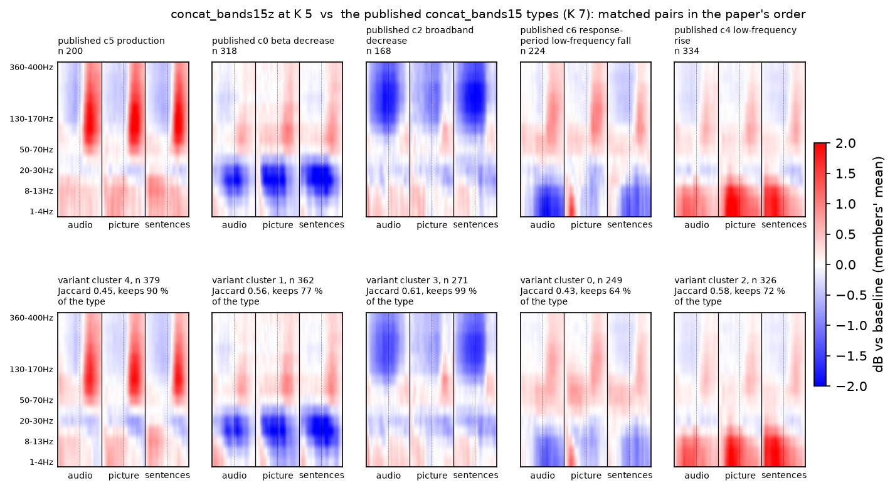

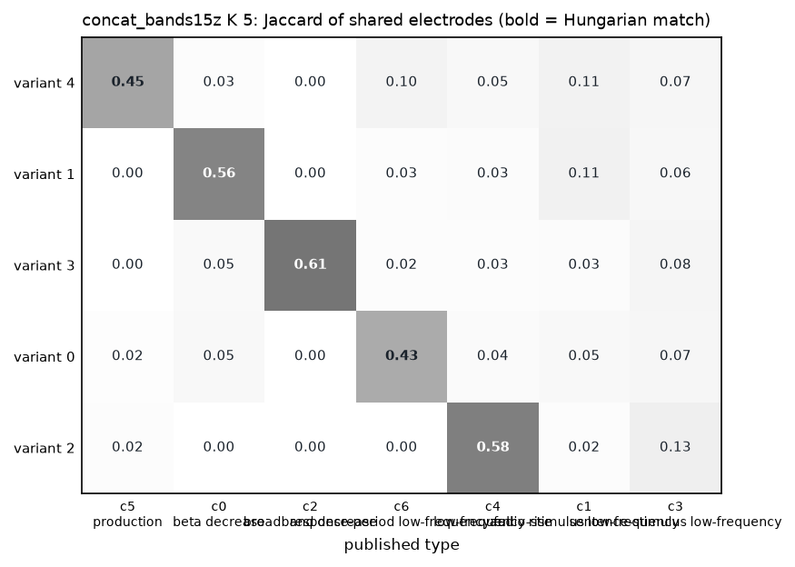

### at K 7 (the paper's K)

ARI 0.38, NMI 0.41 against the published labels; 63 % of the electrodes stay with the type their cluster is matched to; median own loading 0.42.

| variant cluster | n | matched published type | Jaccard | keeps of the type | of the cluster from that type |
|---|---|---|---|---|---|
| 5 | 306 | c5 production | 0.51 | 86 % | 56 % |
| 6 | 299 | c0 beta decrease | 0.54 | 68 % | 73 % |
| 3 | 201 | c2 broadband decrease | 0.68 | 89 % | 74 % |
| 1 | 201 | c6 response-period low-frequency fall | 0.41 | 55 % | 62 % |
| 4 | 317 | c4 low-frequency rise | 0.56 | 70 % | 74 % |
| 0 | 120 | c1 audio-stimulus low-frequency | 0.23 | 34 % | 41 % |
| 2 | 143 | c3 sentence-stimulus low-frequency | 0.23 | 32 % | 44 % |

| electrode | why it is here | published | variant cluster | matched type | own loading |
|---|---|---|---|---|---|
| EL033 PHG_R12 | Figure 1 production row | c5 production | 5 | c5 production | 0.58 |
| PAT_1327 CPG13 | Figure 1 beta-decrease row | c0 beta decrease | 6 | c0 beta decrease | 0.38 |
| PAT_3965 had6 | Figure 1 broadband-decrease row | c2 broadband decrease | 3 | c2 broadband decrease | 0.70 |
| PAT_5533 IPD3 | Figure 1 audio row | c0 beta decrease | 0 | c1 audio-stimulus low-frequency | 0.39 |
| EL043 IOG7 | Figure 1 visual row | c6 response-period low-frequency fall | 2 | c3 sentence-stimulus low-frequency | 0.53 |
| EL042 STG_R5 | most representative c1 | c1 audio-stimulus low-frequency | 0 | c1 audio-stimulus low-frequency | 0.71 |
| EL035 TTG_R1 | types-figure example | c1 audio-stimulus low-frequency | 0 | c1 audio-stimulus low-frequency | 0.96 |

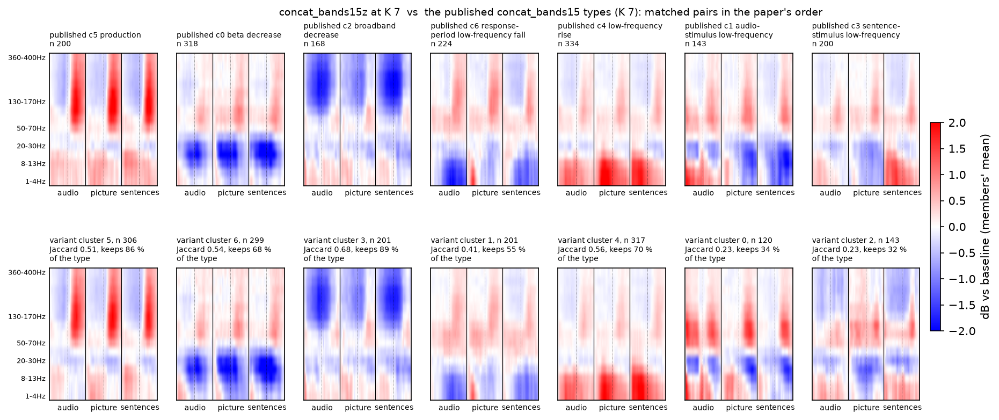

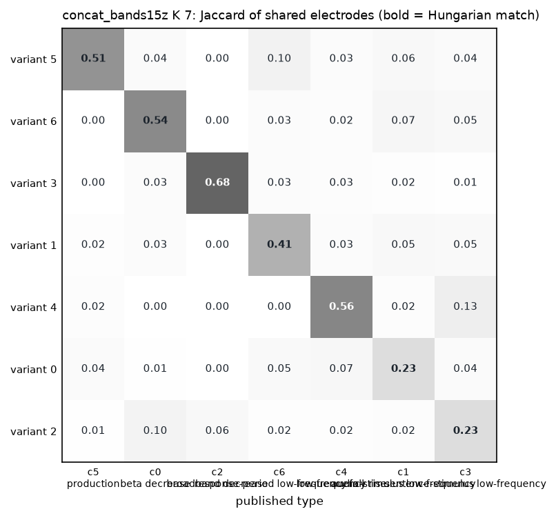

## concat_bands15s · 15 bands, per-band shape within each electrode · run 20261102_222007

### at K 6 (its own K by the rule)

ARI 0.29, NMI 0.35 against the published labels; 54 % of the electrodes stay with the type their cluster is matched to; median own loading 0.45.

| variant cluster | n | matched published type | Jaccard | keeps of the type | of the cluster from that type |
|---|---|---|---|---|---|
| 4 | 301 | c5 production | 0.33 | 62 % | 41 % |
| 0 | 374 | c0 beta decrease | 0.50 | 73 % | 62 % |
| 5 | 240 | c2 broadband decrease | 0.57 | 88 % | 62 % |
| 3 | 252 | c6 response-period low-frequency fall | 0.46 | 67 % | 59 % |
| 1 | 263 | c4 low-frequency rise | 0.32 | 44 % | 56 % |
| 2 | 157 | c3 sentence-stimulus low-frequency | 0.23 | 34 % | 43 % |

| electrode | why it is here | published | variant cluster | matched type | own loading |
|---|---|---|---|---|---|
| EL033 PHG_R12 | Figure 1 production row | c5 production | 4 | c5 production | 0.52 |
| PAT_1327 CPG13 | Figure 1 beta-decrease row | c0 beta decrease | 0 | c0 beta decrease | 0.46 |
| PAT_3965 had6 | Figure 1 broadband-decrease row | c2 broadband decrease | 5 | c2 broadband decrease | 0.71 |
| PAT_5533 IPD3 | Figure 1 audio row | c0 beta decrease | 0 | c0 beta decrease | 0.40 |
| EL043 IOG7 | Figure 1 visual row | c6 response-period low-frequency fall | 2 | c3 sentence-stimulus low-frequency | 0.92 |
| EL042 STG_R5 | most representative c1 | c1 audio-stimulus low-frequency | 0 | c0 beta decrease | 0.42 |
| EL035 TTG_R1 | types-figure example | c1 audio-stimulus low-frequency | 1 | c4 low-frequency rise | 0.55 |

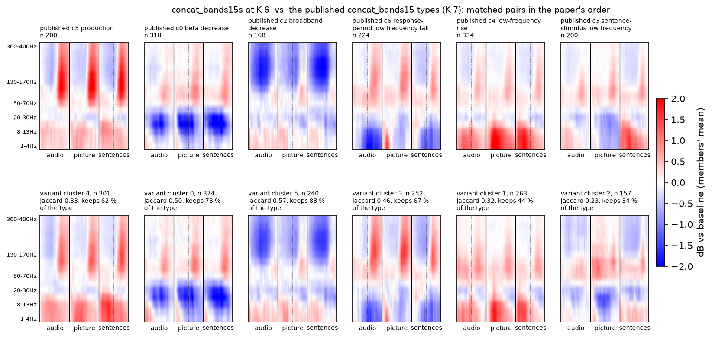

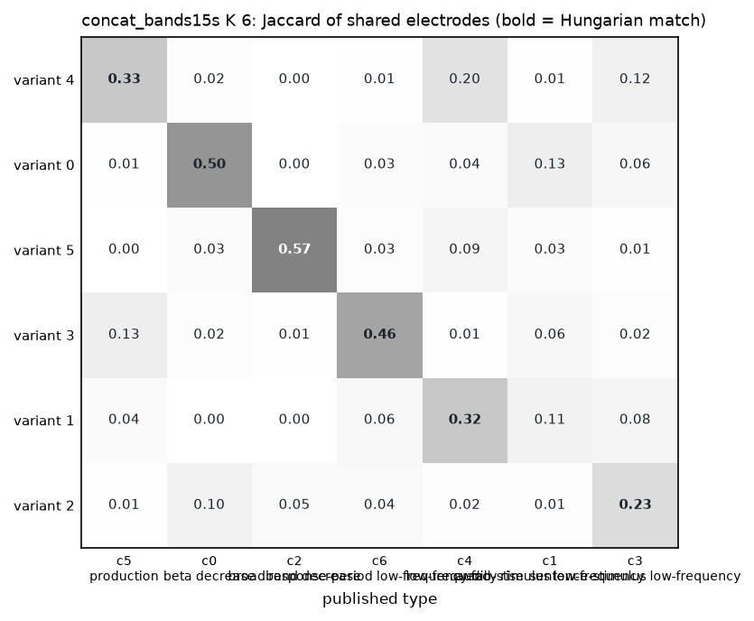

### at K 7 (the paper's K)

ARI 0.29, NMI 0.33 against the published labels; 53 % of the electrodes stay with the type their cluster is matched to; median own loading 0.43.

| variant cluster | n | matched published type | Jaccard | keeps of the type | of the cluster from that type |
|---|---|---|---|---|---|
| 1 | 325 | c5 production | 0.32 | 64 % | 39 % |
| 5 | 333 | c0 beta decrease | 0.57 | 75 % | 71 % |
| 2 | 217 | c2 broadband decrease | 0.56 | 82 % | 64 % |
| 6 | 256 | c6 response-period low-frequency fall | 0.40 | 62 % | 54 % |
| 0 | 190 | c4 low-frequency rise | 0.26 | 32 % | 57 % |
| 3 | 139 | c1 audio-stimulus low-frequency | 0.22 | 36 % | 37 % |
| 4 | 127 | c3 sentence-stimulus low-frequency | 0.18 | 25 % | 39 % |

| electrode | why it is here | published | variant cluster | matched type | own loading |
|---|---|---|---|---|---|
| EL033 PHG_R12 | Figure 1 production row | c5 production | 1 | c5 production | 0.51 |
| PAT_1327 CPG13 | Figure 1 beta-decrease row | c0 beta decrease | 5 | c0 beta decrease | 0.40 |
| PAT_3965 had6 | Figure 1 broadband-decrease row | c2 broadband decrease | 2 | c2 broadband decrease | 0.71 |
| PAT_5533 IPD3 | Figure 1 audio row | c0 beta decrease | 3 | c1 audio-stimulus low-frequency | 0.35 |
| EL043 IOG7 | Figure 1 visual row | c6 response-period low-frequency fall | 0 | c4 low-frequency rise | 0.43 |
| EL042 STG_R5 | most representative c1 | c1 audio-stimulus low-frequency | 3 | c1 audio-stimulus low-frequency | 0.76 |
| EL035 TTG_R1 | types-figure example | c1 audio-stimulus low-frequency | 3 | c1 audio-stimulus low-frequency | 0.85 |

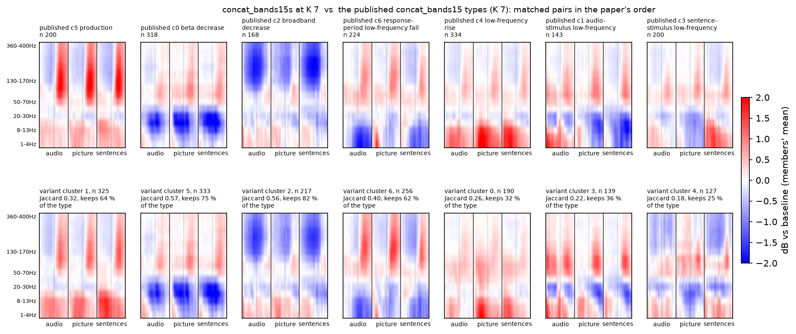

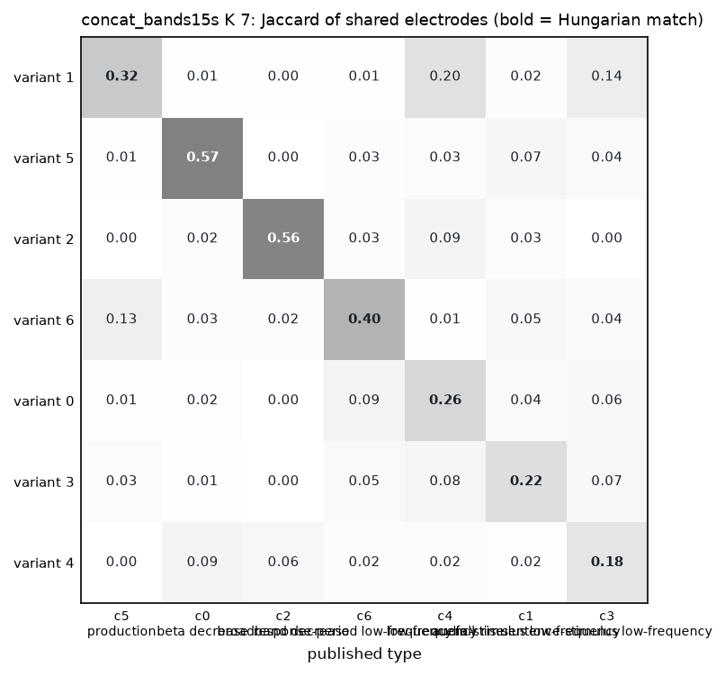

## concat_bands15t · 15 bands, ternary map (+1 / 0 / -1) on the z-scored values · run 20261102_232300

### at K 5 (its own K by the rule)

ARI 0.36, NMI 0.39 against the published labels; 60 % of the electrodes stay with the type their cluster is matched to; median own loading 0.49.

| variant cluster | n | matched published type | Jaccard | keeps of the type | of the cluster from that type |
|---|---|---|---|---|---|
| 0 | 365 | c5 production | 0.47 | 90 % | 49 % |
| 1 | 336 | c0 beta decrease | 0.54 | 72 % | 68 % |
| 2 | 246 | c2 broadband decrease | 0.68 | 99 % | 68 % |
| 3 | 293 | c6 response-period low-frequency fall | 0.37 | 62 % | 48 % |
| 4 | 347 | c4 low-frequency rise | 0.54 | 71 % | 69 % |

| electrode | why it is here | published | variant cluster | matched type | own loading |
|---|---|---|---|---|---|
| EL033 PHG_R12 | Figure 1 production row | c5 production | 0 | c5 production | 0.56 |
| PAT_1327 CPG13 | Figure 1 beta-decrease row | c0 beta decrease | 1 | c0 beta decrease | 0.47 |
| PAT_3965 had6 | Figure 1 broadband-decrease row | c2 broadband decrease | 2 | c2 broadband decrease | 0.77 |
| PAT_5533 IPD3 | Figure 1 audio row | c0 beta decrease | 0 | c5 production | 0.39 |
| EL043 IOG7 | Figure 1 visual row | c6 response-period low-frequency fall | 3 | c6 response-period low-frequency fall | 1.00 |
| EL042 STG_R5 | most representative c1 | c1 audio-stimulus low-frequency | 1 | c0 beta decrease | 0.48 |
| EL035 TTG_R1 | types-figure example | c1 audio-stimulus low-frequency | 0 | c5 production | 0.32 |

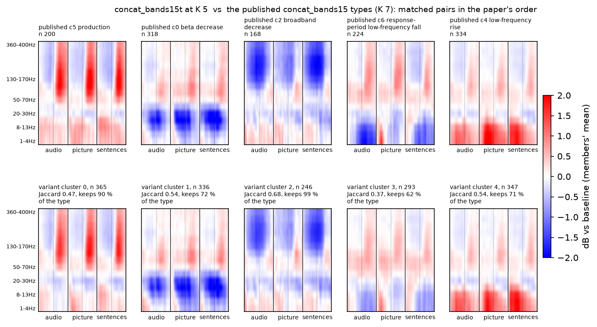

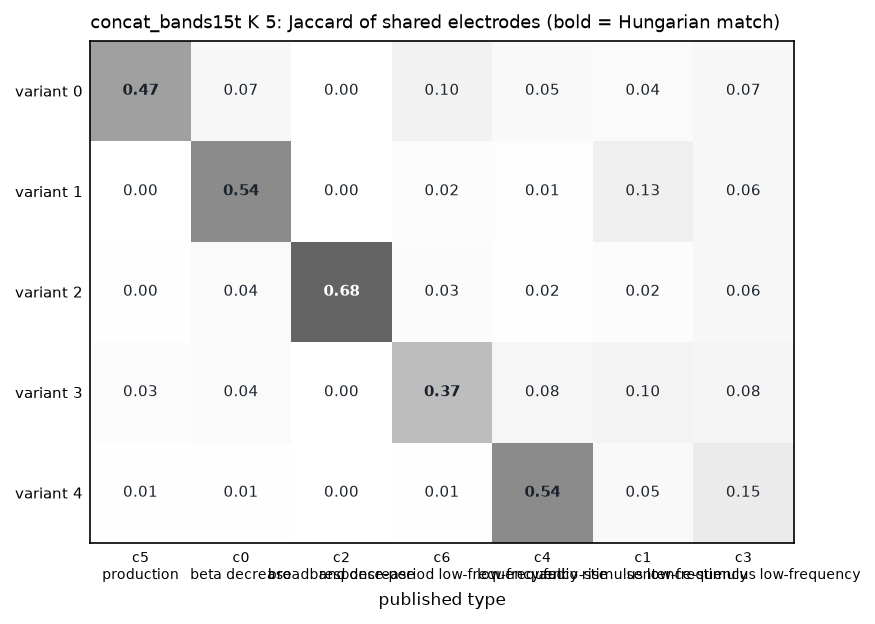

### at K 7 (the paper's K)

ARI 0.32, NMI 0.39 against the published labels; 55 % of the electrodes stay with the type their cluster is matched to; median own loading 0.43.

| variant cluster | n | matched published type | Jaccard | keeps of the type | of the cluster from that type |
|---|---|---|---|---|---|
| 6 | 355 | c5 production | 0.48 | 90 % | 50 % |
| 1 | 242 | c0 beta decrease | 0.30 | 40 % | 53 % |
| 4 | 156 | c2 broadband decrease | 0.60 | 72 % | 78 % |
| 5 | 246 | c6 response-period low-frequency fall | 0.40 | 60 % | 55 % |
| 0 | 316 | c4 low-frequency rise | 0.56 | 69 % | 73 % |
| 2 | 76 | c1 audio-stimulus low-frequency | 0.01 | 2 % | 4 % |
| 3 | 196 | c3 sentence-stimulus low-frequency | 0.21 | 34 % | 35 % |

| electrode | why it is here | published | variant cluster | matched type | own loading |
|---|---|---|---|---|---|
| EL033 PHG_R12 | Figure 1 production row | c5 production | 6 | c5 production | 0.54 |
| PAT_1327 CPG13 | Figure 1 beta-decrease row | c0 beta decrease | 1 | c0 beta decrease | 0.35 |
| PAT_3965 had6 | Figure 1 broadband-decrease row | c2 broadband decrease | 4 | c2 broadband decrease | 0.65 |
| PAT_5533 IPD3 | Figure 1 audio row | c0 beta decrease | 6 | c5 production | 0.41 |
| EL043 IOG7 | Figure 1 visual row | c6 response-period low-frequency fall | 5 | c6 response-period low-frequency fall | 0.64 |
| EL042 STG_R5 | most representative c1 | c1 audio-stimulus low-frequency | 1 | c0 beta decrease | 0.66 |
| EL035 TTG_R1 | types-figure example | c1 audio-stimulus low-frequency | 6 | c5 production | 0.38 |

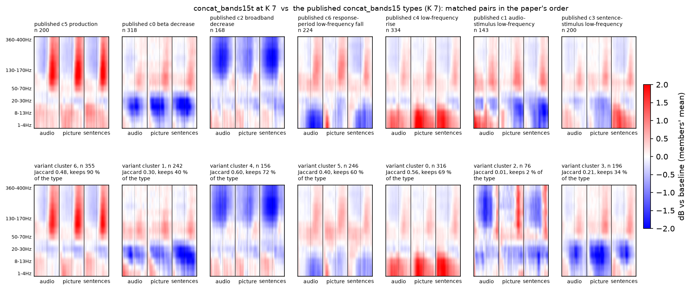

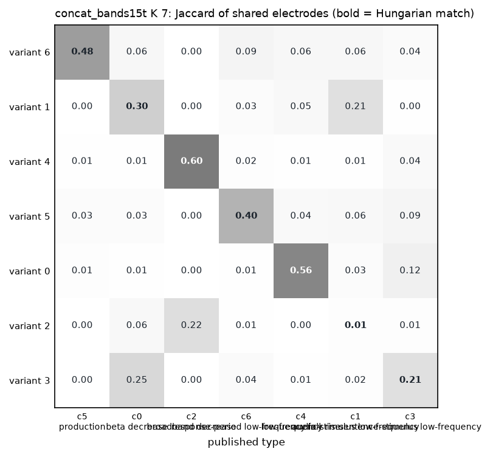

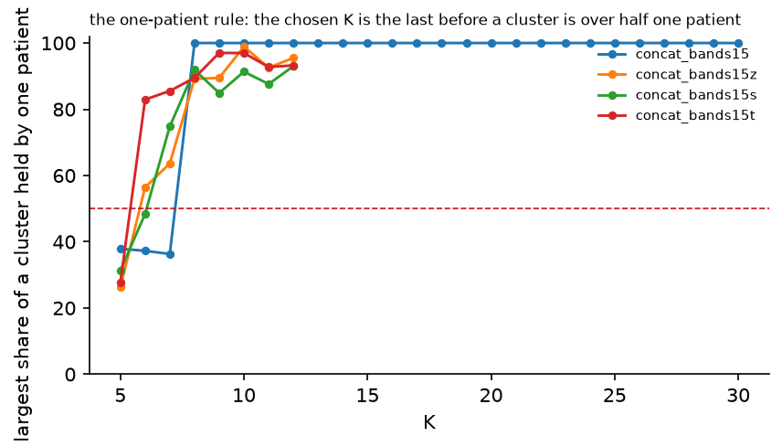

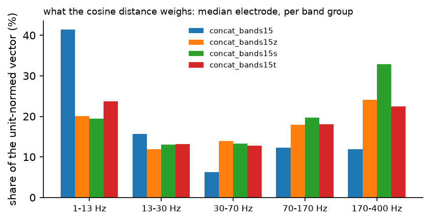
