# Paper 2 · how the seven response types were validated

*Built 2026-10-27 12:56 from the output files of cohort concat_source_v17, run 20261017_194301; every number below is read from a file named in `numbers.json`.*

Three questions decide whether a clustering is a result or an artefact. **Agreement**: do other descriptions and other algorithms find the same shapes? **Stability**: do the shapes come back when the patients change? **Separation**: are the shapes distinct from one another, and in which features? The sections below put the existing figures in that order, add the two that were missing (separation, scorecard), and end with anatomy as context.

## 0 · Task and cohort

**Question.** What was recorded, and which electrodes enter the clustering?

**How.** Three naming conditions (an auditory stimulus, a picture, a written sentence); each trial is a stimulus and then a response cue, and the time axis is warped so the cue falls at the middle of every block. An electrode enters when at least one condition passes the responsiveness gate: at least 2 % of its bins above +2.2 dB (618 bins) of the 0–400 Hz ERSP, or the mirror rule for decreases.

**What a good result looks like.** A cohort that is large and many-patient, with the gate behaving like a filter on responsiveness rather than on patients.

**Found.** 2917 electrodes seen, 1587 kept (54 %) in 29 patients; the per-patient gate rate runs from 6 % (PAT_5515) to 95 %.

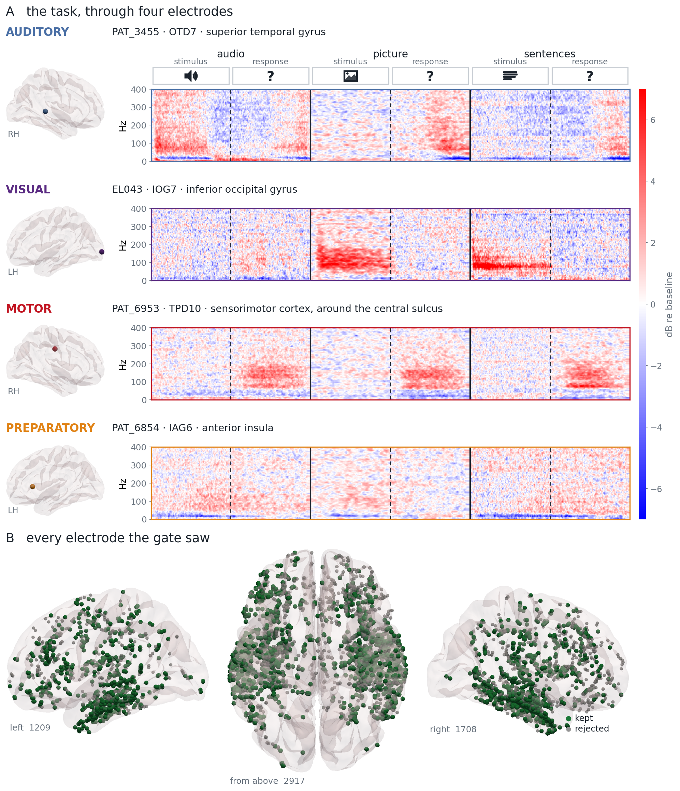

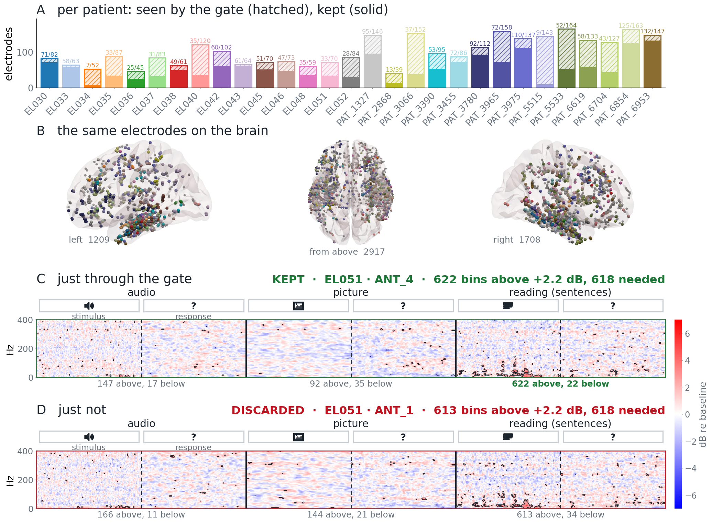

**Takeaway.** The task and the cohort are fixed before any clustering; the gate keeps about half of what was implanted. **Caveat.** The kept set is not a random sample of cortex: it is where responsive contacts happened to be, which the anatomy section has to live with.

## 1 · The types: seven recurring response shapes

**Question.** What are the recurring shapes, and who carries them?

**How.** Convex NMF on the 15 bands × 30 time bins × 3 conditions description of every electrode (unit-norm rows), K = 7. An electrode's type is the component with its largest loading; the loadings are drawn, and electrodes below a loading of 0.3 are not drawn, but every count and test uses the argmax membership. Each block shows the type's mean ERSP, both hemispheres from their own side, and the patients it is made of.

**What a good result looks like.** Every type drawn from many patients, none more than half from one patient.

**Found.** c5 production n 200 (17 patients, largest 17 %), c0 beta decrease n 318 (22 patients, largest 25 %), c2 broadband decrease n 168 (11 patients, largest 36 %), c6 response-period low-frequency fall n 224 (24 patients, largest 25 %), c4 low-frequency rise n 334 (28 patients, largest 12 %), c1 audio-stimulus low-frequency n 143 (22 patients, largest 20 %), c3 reading-stimulus low-frequency n 200 (25 patients, largest 18 %). The median own-type loading is 0.41; 15.5 % of the electrodes sit below the 0.3 draw cut.

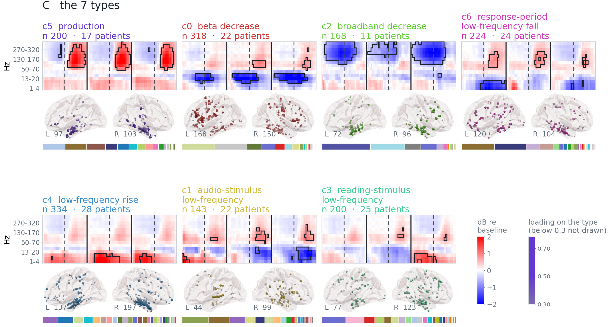

**Takeaway.** Seven shapes, each spanning 11 to 28 patients. **Caveat.** The names are descriptive labels read off the blocks; the loadings are mixed (median 0.41), which is what the separation section measures.

## 2 · Agreement: other descriptions and other algorithms find the same shapes

**Question.** Do the four frequency descriptions (15, 5, 2 bands, HFA) and the three algorithms (convex NMF, k-means, Ward) place the electrodes alike?

**How.**

- **ARI.** For every pair of electrodes, do both solutions agree (together in both, or apart in both)? The share of agreeing pairs is the Rand index; ARI corrects it for chance, so 0 is chance and 1 identical.
- **NMI.** How much knowing an electrode's cluster in one solution tells you about its cluster in the other: I(A;B) / mean(H(A), H(B)).
- **Modal agreement.** Relabel every solution to match the reference (Hungarian matching), then count, per electrode, how many solutions give it the same label.
- **Diagonal share.** Cross-tabulate two solutions, pair the clusters one-to-one to maximise the overlap, then the share of electrodes in the matched pairs; chance is the same share after shuffling one solution's labels.
- **Jaccard / adjusted overlap.** |A ∩ B| / |A ∪ B| for a matched pair of clusters; the adjusted overlap (J − J₀)/(1 − J₀) sets chance to 0.

**What a good result looks like.** ARI well above 0; all-solutions agreement well above its chance (0.6 % for four feature sets, 3.1 % for three algorithms, from the FIG 2 caption); diagonal shares well above the shuffled chance of about 0.18.

**Found.** Across algorithms ARI 0.51 (k-means vs convex NMF) to 0.26 (Ward vs convex NMF), NMI 0.56 to 0.36; across feature sets ARI 0.38 (15 bands vs 5 bands) to 0.07 (5 bands vs HFA). All three algorithms agree on 47 % of the electrodes, all four feature sets on 11 %. Matched clusters: convex NMF against k-means puts 0.73 of the electrodes on the matched diagonal (chance 0.14), against Ward 0.52; 15 bands against 5 bands 0.60, against HFA 0.21. Pairs clearing both nulls: convex NMF vs kmeans 7/7, convex NMF vs Ward 7/7, kmeans_vs_Ward 7/7, cnmf_vs_concat_5 bands 6/7, cnmf_vs_concat_2 bands 7/7, cnmf_vs_concat_HFA 3/7. Over all 66 pairs of solutions at K = 7, the median diagonal share is 0.55 across algorithms, 0.38 across feature sets and 0.36 when both differ (chance 0.18); 0 of 66 pairs fail to beat chance.

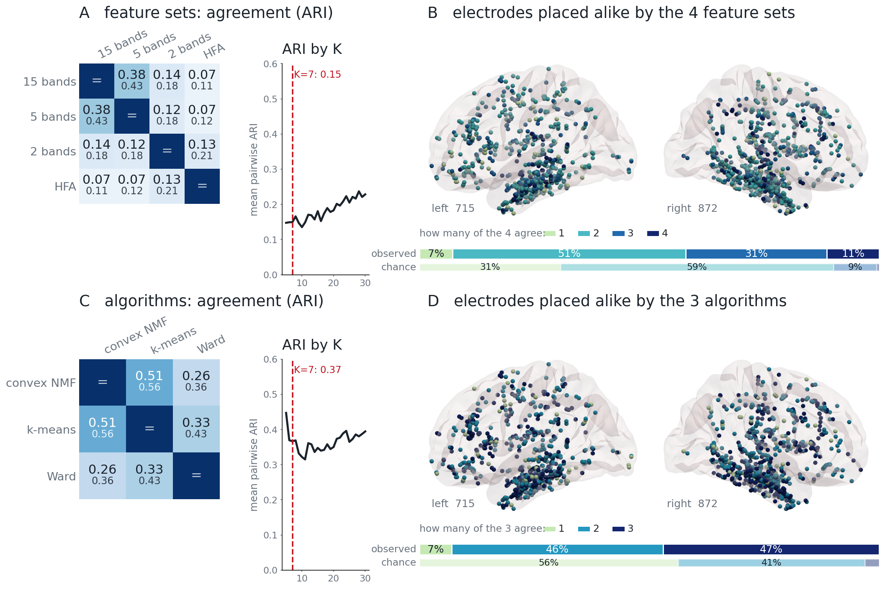

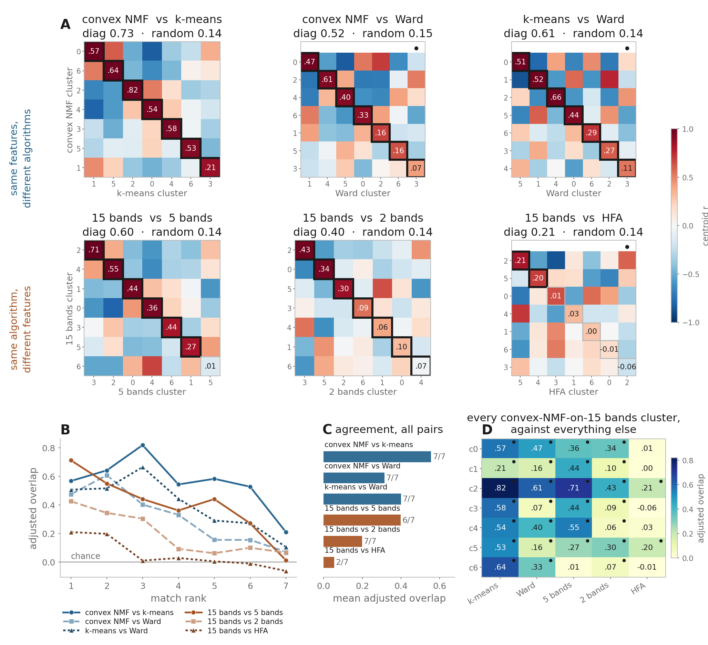

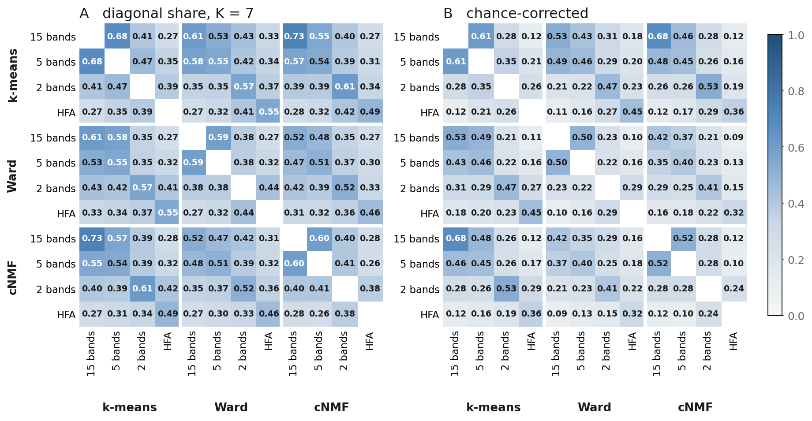

**Takeaway.** Changing the algorithm moves the electrodes less than changing the frequency description; the description matters more than the algorithm. **Caveat.** Agreement is not correctness: four descriptions can agree on a shape that is an artefact of the gate or of the warp, and nothing here is a statistical test of the types themselves.

## 3 · Stability: the same shapes come back when patients are resampled

**Question.** Do the types survive a change of patients, and is K = 7 the right place to stop?

**How.**

- **One-patient clusters over K.** At every K, the share of clusters more than half from one patient and the share of electrodes in them.
- **PAC.** Refit on 80 % of the patients 200 times; M = how often two electrodes land together; PAC = share of pairs with 0.1 < M < 0.9 (lower is more stable). The null is the Gaussian cloud: one distribution with the data's covariance and no clusters, through the same procedure.
- **Per-type consensus.** Mean M over the pairs inside a type.
- **Leave one patient out.** Drop a patient, refit, ARI against the full-cohort labels, against size-matched pseudo-patients made of shuffled shafts; and place the dropped patient's electrodes with the refit's components and count how many land in their full-cohort type.
- **K 7 → K 8.** The diagonal share between the K 7 and K 8 partitions of the same run.

**What a good result looks like.** PAC below the cloud; no cluster owned by one patient; per-type consensus above 0.6; leave-one-patient-out ARI high and no worse than for a pseudo-patient; most of the partition kept at K + 1.

**Found.** At K = 7 no cluster is more than half one patient (worst 39 %, PAT_3965 in c0); at K = 8 one cluster is 100 % one patient, and the consensus partition fails the same rule at K = 6 and at every K from 8 up. PAC 0.234 against 0.428 ± 0.031 for the cloud (p 0.04, the floor of 25 draws; RCSI 0.61). Per-type consensus c4 low-frequency rise 0.82, c2 broadband decrease 0.79, c5 production 0.78, c6 response-period low-frequency fall 0.75, c0 beta decrease 0.72, c1 audio-stimulus low-frequency 0.64, c3 reading-stimulus low-frequency 0.59. Leave one patient out: median ARI 0.87 (minimum 0.76) against 0.88 ± 0.02 for the pseudo-patients (z -0.7); placement accuracy median 0.93 against a chance of 0.52 (worst patient EL051, 0.64). K 7 → K 8 keeps 0.90 of the electrodes in matched pairs (chance-corrected 0.88), K 7 → K 10 0.68.

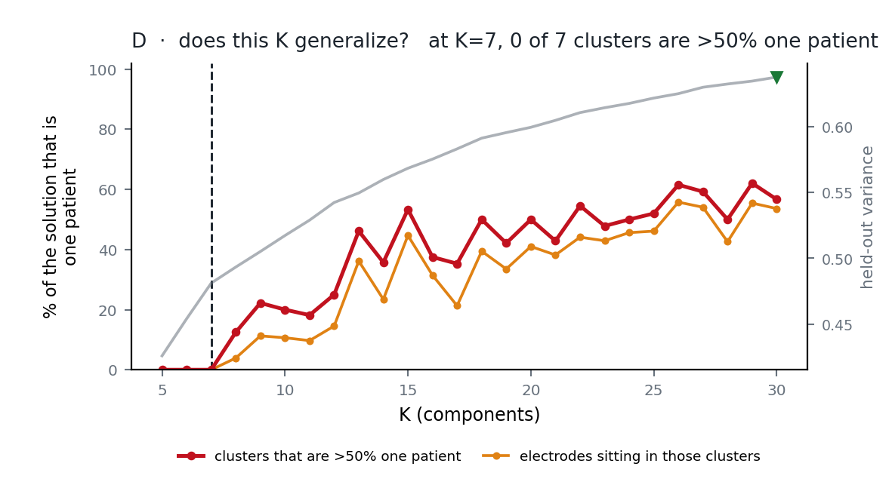

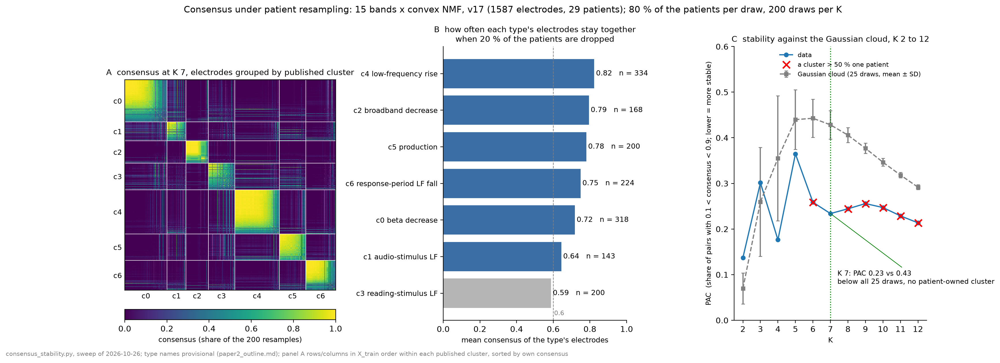

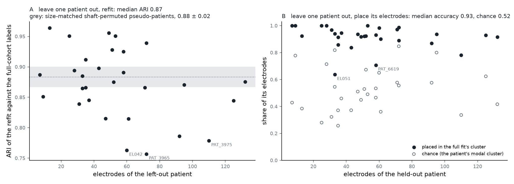

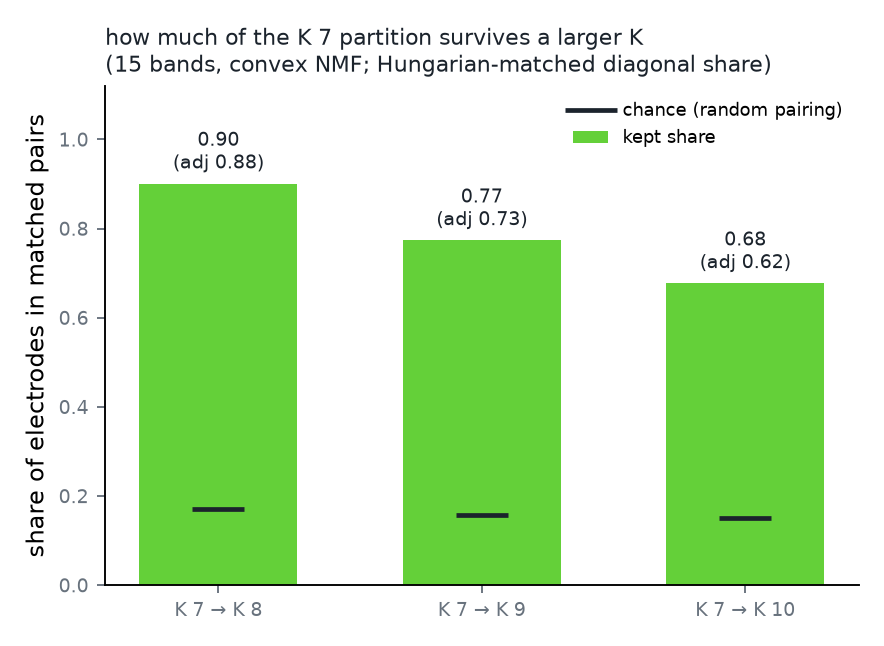

**Takeaway.** The shapes come back under patient resampling, and K = 7 is the last K before a patient owns a cluster. **Caveat.** The cloud has no patient structure, so a K whose clusters follow patients can look stable against it: the dominance rule is the guard. The sweep's own K criterion (RCSI) prefers K = 4 (RCSI 0.70, p 0.23), so consensus is support for the K 7 solution, not the reason for it. Leave-one-patient-out ARI is no better than for a pseudo-patient (z -0.7): dropping a real patient costs no more than dropping the same number of shafts at random, which is the absence of a dominant patient, not a separate virtue.

## 4 · Separation: distinct, but only partly

**Question.** Are the types different distributions, how far apart, and in which features?

**How.**

- **Silhouette.** (b − a) / max(a, b), a = mean distance to the own cluster, b = to the nearest other cluster, on the unit-norm rows; z-scored against the Gaussian cloud clustered the same way. Per type, the mean of its electrodes' silhouettes against the cloud's per-cluster values.
- **MMD².** Mean kernel similarity within A + within B − 2 × between (Gaussian kernel, one median bandwidth), the unbiased estimate; 0 means the same distribution. In-sample it is tested against labels shuffled within patient, which is circular because the labels were fitted on these electrodes. The test that counts is on held-out patients: refit on half the patients, place the other half, MMD² between the placed groups, shuffled within patient; its scale is the Gaussian cloud through the same procedure, whose sectors are convex pieces of one featureless distribution and therefore well apart by construction.
- **Where.** Per bin, the standardised mean difference between the two types with the same within-patient shuffle; the bars are each band's share of the linear-kernel MMD².

**What a good result looks like.** Silhouette z well above 0 overall and per type; every pair different on held-out patients; MMD² above the cloud's sectors for the pairs that are claimed to be distinct.

**Found.** Overall silhouette 0.065 against 0.028 ± 0.0019 for 50 clouds (z 19). Per type, z against the cloud: c2 broadband decrease +4.9, c0 beta decrease +2.6, c5 production +2.1, c4 low-frequency rise +1.2, c6 response-period low-frequency fall +0.4, c1 audio-stimulus low-frequency +0.3, c3 reading-stimulus low-frequency -1.3. MMD (5000 in-sample shuffles, 100 patient halves with 500 shuffles each, 100 cloud draws, bandwidth 1.33): every one of the 21 pairs differs on held-out patients (shuffle p < 0.05 in at least 95 % of the splits). Held-out MMD² runs from 0.097 (c0 vs c1) to 0.244 (c0 vs c4); the cloud's sectors sit at 0.123, so 14 pairs are further apart than two sectors of a featureless cloud and 7 are closer: c0–c1 0.79×, c4–c5 0.84×, c1–c6 0.87×, c0–c6 0.88×, c0–c3 0.96×, c1–c3 0.98×, c3–c5 0.99×. Nearest neighbours: c5 production → c4 (0.84×), c0 beta decrease → c1 (0.79×), c2 broadband decrease → c3 (1.51×), c6 response-period low-frequency fall → c1 (0.87×), c4 low-frequency rise → c5 (0.84×), c1 audio-stimulus low-frequency → c0 (0.79×), c3 reading-stimulus low-frequency → c0 (0.96×). With the 0.3 loading cut (15.5 % of the electrodes removed, the cloud cut by the same fraction) the ordering is the same and the ratios run 0.80 to 1.92. What drives the most separated pair (c0 vs c4): 8-13 Hz 27 %, 13-20 Hz 24 %, 4-8 Hz 20 %; by condition audio 17 %, picture 47 %, reading 37 %. The least separated (c0 vs c1): 13-20 Hz 28 %, 8-13 Hz 19 %, 1-4 Hz 15 %; by condition audio 43 %, picture 27 %, reading 30 %.

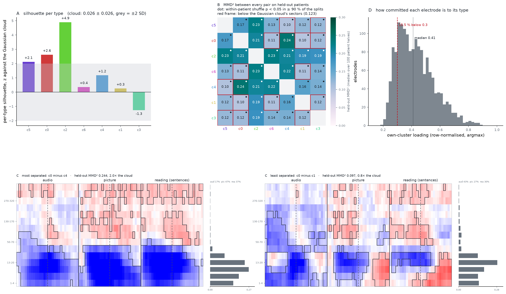

**Takeaway.** The types are distinct: every pair differs on patients the model never saw, and the strongest types sit further apart than sectors of a featureless cloud. They are distinct only partly: the weakest pairs are closer than such sectors, the loadings are mixed (median 0.41), and a reading of the types as regions on a continuum of responses is consistent with these numbers. **Caveat.** In-sample p-values are circular and are not the test; the cloud is a harsh yardstick because clustering carves it into maximally separated pieces.

## 5 · Scorecard: each type on all three

**Question.** Which types are solid on agreement, stability and separation, and which are fragile?

**How.** One row per type; the columns are the per-type numbers of sections 2 to 4: the chance-adjusted overlap of its matched cluster across the two other algorithms and across the three other feature sets (FIG 4), its consensus under patient resampling, its silhouette z against the cloud, the held-out MMD² to its nearest other type, and the number of patients and the largest patient's share. Colour is the rank within a column, not a composite score.

**What a good result looks like.** Dark across the row.

**Found.** c5 production: overlap 0.34 across algorithms and 0.26 across feature sets, consensus 0.78, silhouette z +2.1, nearest type 0.84× the cloud, 17 patients, largest 17 %. c0 beta decrease: overlap 0.52 across algorithms and 0.24 across feature sets, consensus 0.72, silhouette z +2.6, nearest type 0.79× the cloud, 22 patients, largest 25 %. c2 broadband decrease: overlap 0.71 across algorithms and 0.45 across feature sets, consensus 0.79, silhouette z +4.9, nearest type 1.51× the cloud, 11 patients, largest 36 %. c6 response-period low-frequency fall: overlap 0.49 across algorithms and 0.02 across feature sets, consensus 0.75, silhouette z +0.4, nearest type 0.87× the cloud, 24 patients, largest 25 %. c4 low-frequency rise: overlap 0.47 across algorithms and 0.21 across feature sets, consensus 0.82, silhouette z +1.2, nearest type 0.84× the cloud, 28 patients, largest 12 %. c1 audio-stimulus low-frequency: overlap 0.18 across algorithms and 0.18 across feature sets, consensus 0.64, silhouette z +0.3, nearest type 0.79× the cloud, 22 patients, largest 20 %. c3 reading-stimulus low-frequency: overlap 0.33 across algorithms and 0.16 across feature sets, consensus 0.59, silhouette z -1.3, nearest type 0.96× the cloud, 25 patients, largest 18 %.

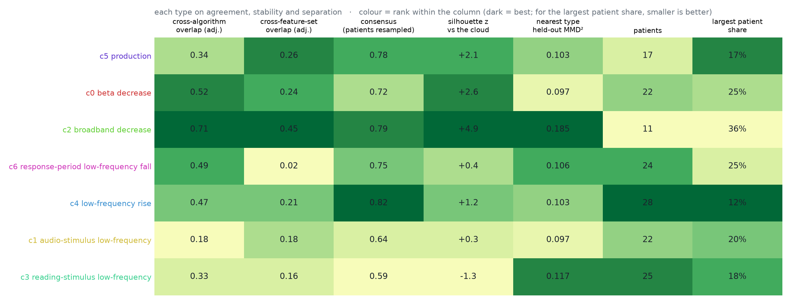

**Takeaway.** Solid on all three: c2 broadband decrease. Fragile on agreement and stability alike: c1 audio-stimulus low-frequency, c3 reading-stimulus low-frequency. The rest split by question: c5 production is stable under resampling (0.78) with agreement 0.34 across algorithms and 0.26 across feature sets, silhouette z +2.1; c0 beta decrease is middling under resampling (0.72) with agreement 0.52 across algorithms and 0.24 across feature sets, silhouette z +2.6; c6 response-period low-frequency fall is middling under resampling (0.75) with agreement 0.49 across algorithms and 0.02 across feature sets, silhouette z +0.4; c4 low-frequency rise is stable under resampling (0.82) with agreement 0.47 across algorithms and 0.21 across feature sets, silhouette z +1.2. **Caveat.** The columns are on different scales and different nulls; the card ranks, it does not sum.

## 6 · Anatomy: where the types sit relative to the language atlas (context, not validation)

**Question.** Does the probabilistic language atlas (LanA) place any type?

**How.** Each electrode's atlas probability P(LanA); per type the mean P and the share inside the network at P ≥ 0.1, against a shaft-shift null that keeps spatial smoothness and a within-patient shuffle that does not, Benjamini-Hochberg over the types; and a spin null that rotates the atlas on the sphere, electrodes fixed.

**What a good result looks like.** For validation, nothing in particular: anatomy is where the types are, not whether they are real.

**Found.** Mean P(LanA) per type c5 production 0.17, c0 beta decrease 0.11, c2 broadband decrease 0.13, c6 response-period low-frequency fall 0.12, c4 low-frequency rise 0.16, c1 audio-stimulus low-frequency 0.21, c3 reading-stimulus low-frequency 0.12 against a cohort baseline of 0.14. Against the shaft-shift null, the share inside the network clears it for c5 (q 0.036); the mean P clears it for no type, and for c1 only against the within-patient shuffle. Spin null (5000 spins): the network's own response is not beyond spun maps (p 0.37 all electrodes, 0.17 left hemisphere); 0 of 7 inside shares beat the spun maps on all electrodes, 0 on the left; the mean P beats them for c1 on the left.

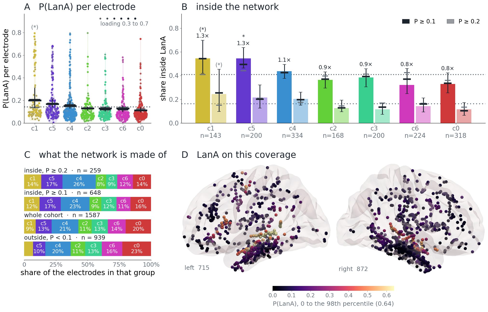

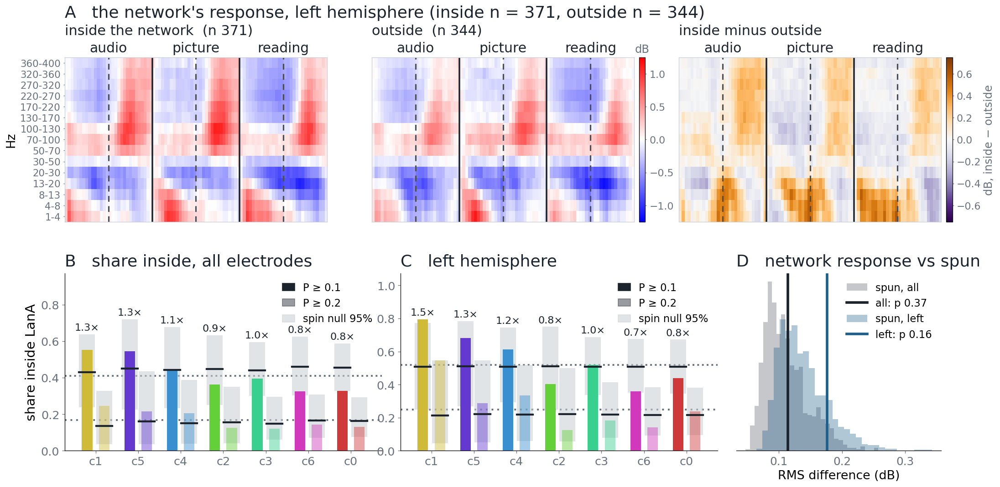

**Takeaway.** No type is placed by the language atlas beyond one modest effect. **Caveat.** Coverage is not symmetric and not random; the atlas is a prior about location, not a measurement in these patients.

## Supplement

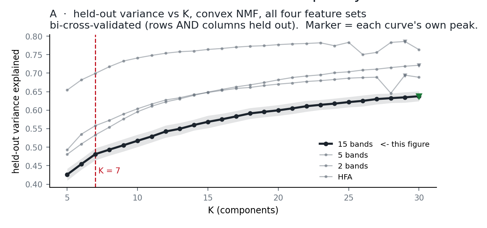

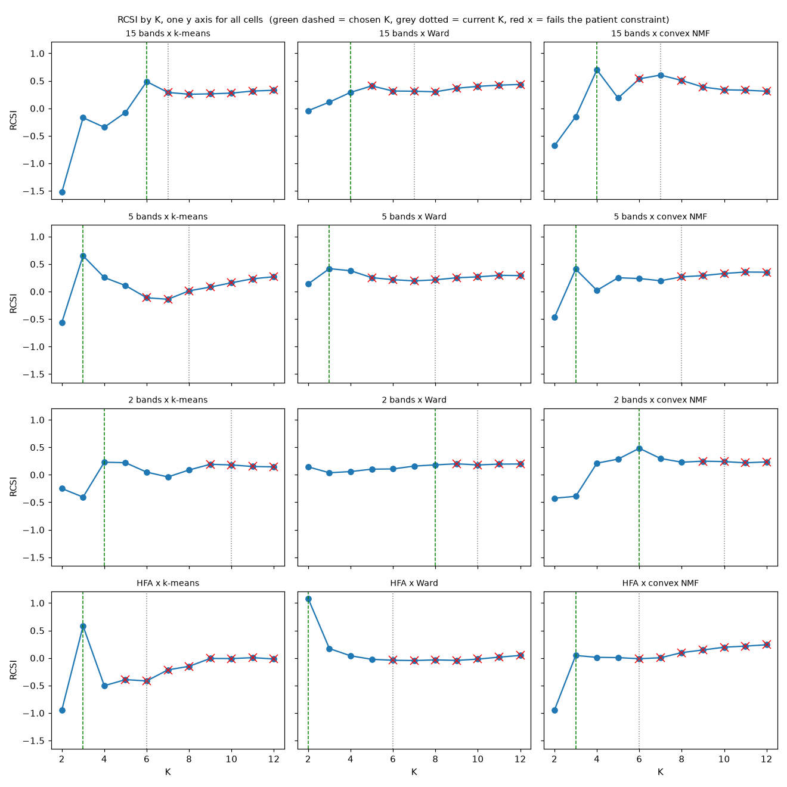

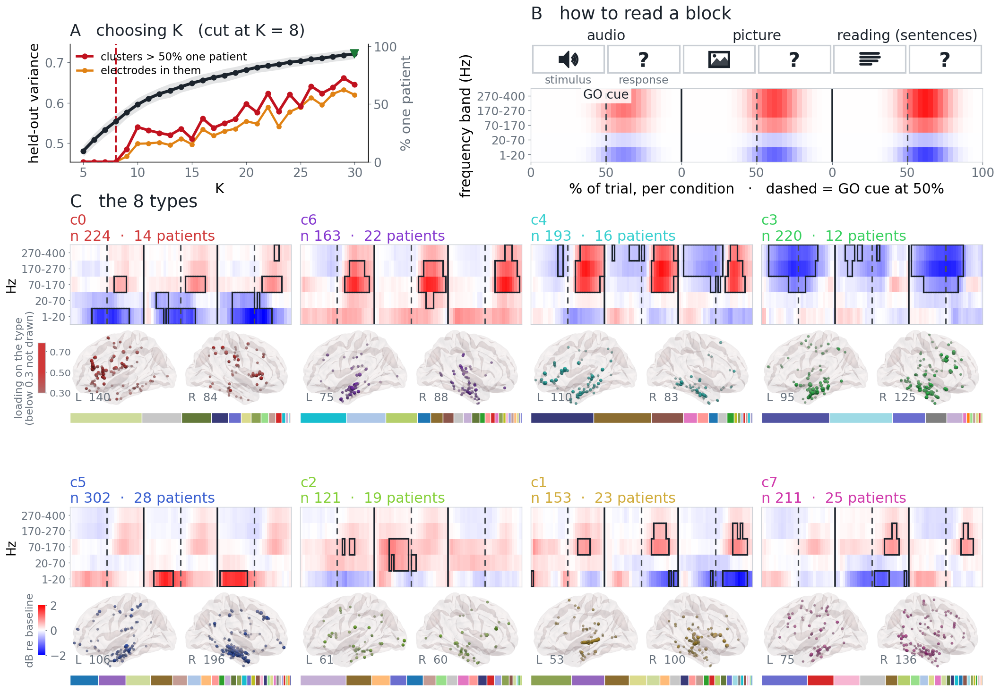

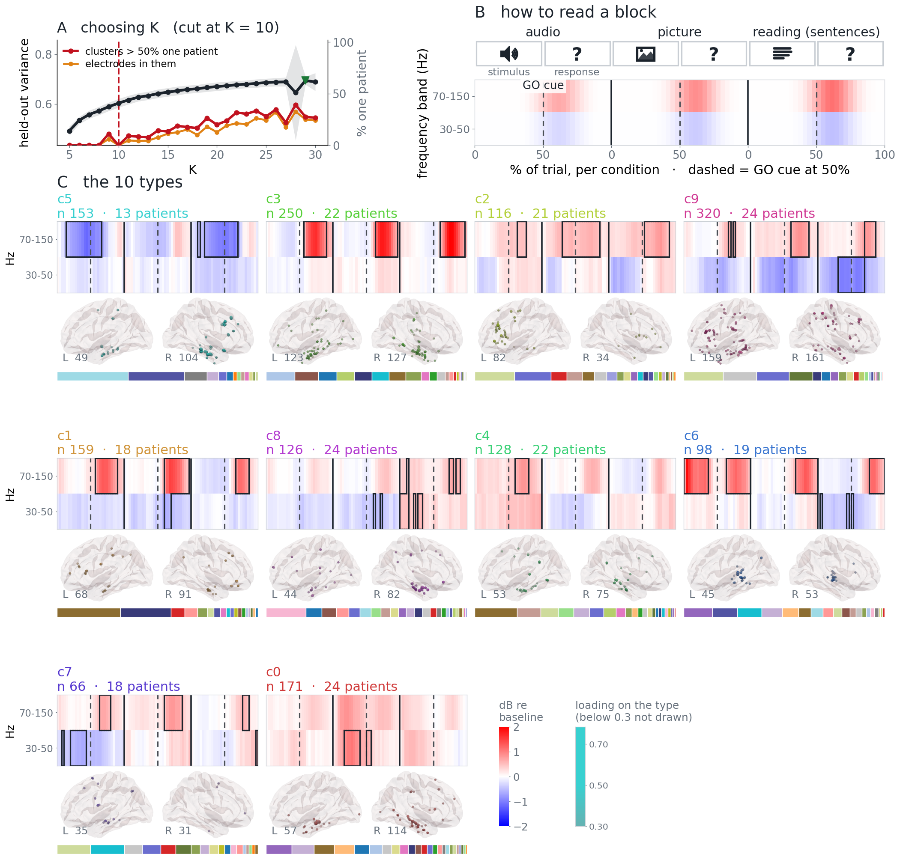

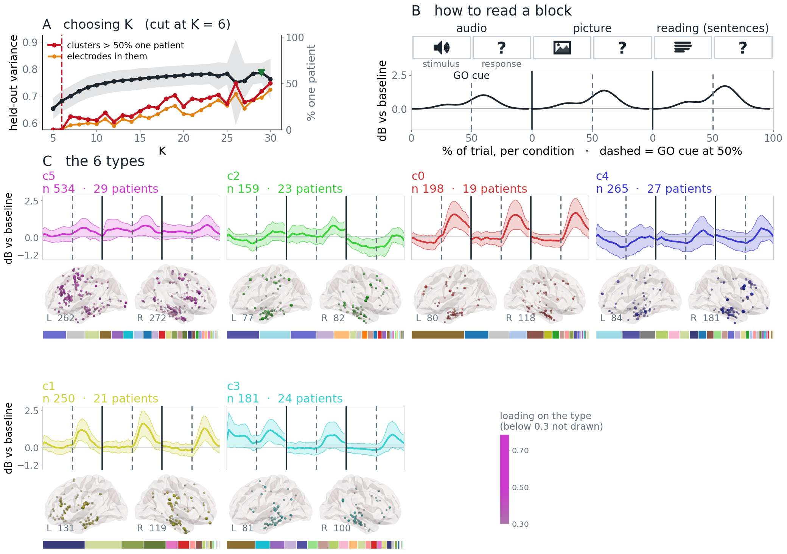

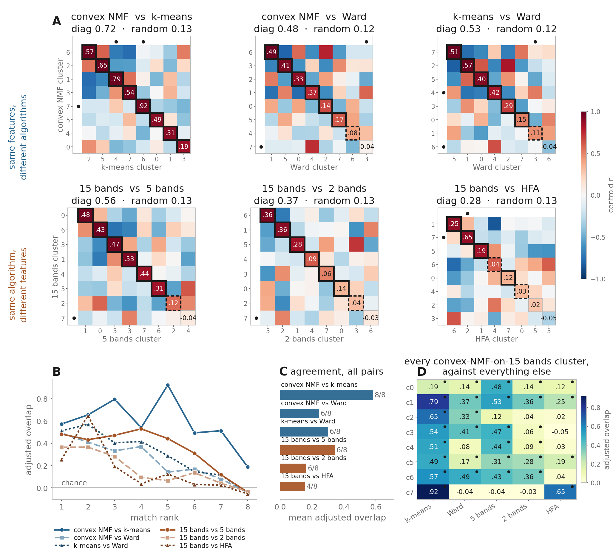

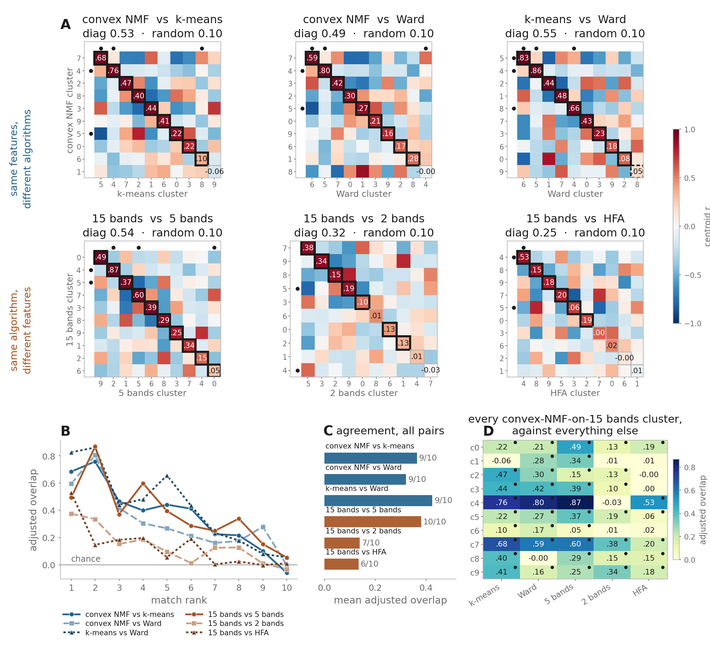

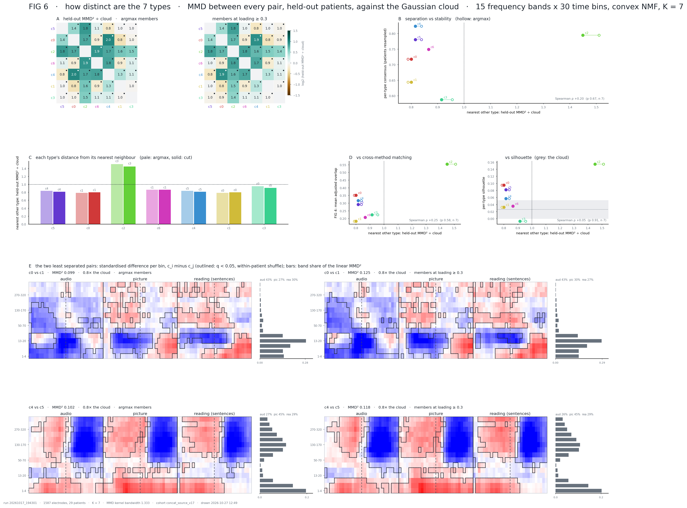

## Where the brief and the files disagree

The files win; each point names the file.

- "c2 and c5 solid": c2 yes (overlap 0.71 across algorithms, 0.45 across feature sets, consensus 0.79, silhouette z +4.9). c5 is solid under resampling (0.78) and on silhouette (z +2.1) but not across methods: 0.34 across algorithms (0.16 against Ward) and 0.26 across feature sets (FIG4_matched).
- "c4 fragile across methods, most stable under resampling": across algorithms c4 is middling (0.47); it is fragile across feature sets (0.21; 0.06 on 2 bands, 0.03 on HFA). Most stable holds by a hair: 0.823 against c2's 0.794 (items_k07).
- "c1 and c3 fragile": confirmed on all three (overlap 0.18/0.33 across algorithms, 0.18/0.16 across feature sets, consensus 0.64/0.59, silhouette z +0.3/-1.3).
- "K 7 → K 8 kept 0.90": the file says 0.900 (chance-corrected 0.88) - confirmed.
- "K 7 is the most clusters before one patient owns a cluster": confirmed - at K = 8 one cluster is 100 % one patient (FIG1a generalization), and the consensus partition fails the rule at K = 6 and at every K from 8 up (results.json).
- Scorecard "Jaccard": FIG 4's per-type numbers are the chance-adjusted overlap; the card shows that and names it, the raw Jaccard is in numbers.json.
- "Leave-one-patient-out vs size-matched pseudo-patients": the file's null is shaft-permuted pseudo-patients, and for convex NMF the real ARI is not above it (z -0.7); the panel is per patient, not per cluster, because the tables are per patient.
- "Per-type consensus (from the consensus slide)": the slide's values are by consensus cluster id (0.82, 0.82, 0.76, 0.76, 0.72, 0.62, 0.58); the document uses the mean own-cluster consensus of each published type's electrodes (items_k07), which differs in the second decimal.
- The silhouette z per type and the MMD numbers did not exist before today; they come from 00_paper2_figure6_mmd.py's tables (outputs/clustering/mmd/).

## Sources

- cohort: `outputs\clustering\paper_figures\FIG0_cohort_supplement_v17_patients.csv`
- types: `outputs\clustering\paper_figures\FIG1a_concat_bands15_cnmf_K7_run20261017-194301_patients.csv`
- generalization: `outputs\clustering\paper_figures\FIG1a_concat_bands15_cnmf_K7_run20261017-194301_generalization.csv`
- agreement_algorithms: `outputs\clustering\statistics\concat_bands15_K7\stats_agreement.csv`
- agreement_feature_sets: `recomputed from the four runs' published labels (as FIG 2 does)`
- modal_agreement: `outputs\clustering\paper_figures\FIG2_agreement_concat_bands15_K7_run20261017-194301_electrode_agreement.csv`
- fig4_summary: `outputs\clustering\paper_figures\FIG4_summary_K07_run20261017-194301.csv`
- fig4_matched: `outputs\clustering\paper_figures\FIG4_matched_K07_run20261017-194301.csv`
- fig5_pairs: `outputs\clustering\paper_figures\FIG5_pairs_K07_run20261017-194301.csv`
- consensus_results: `outputs\clustering\consensus\concat_source_v17\concat_bands15\cnmf\results.json`
- consensus_items: `outputs\clustering\consensus\concat_source_v17\concat_bands15\cnmf\items_k07.csv`
- consensus_clusters: `outputs\clustering\consensus\concat_source_v17\concat_bands15\cnmf\clusters_k07.csv`
- lopo: `outputs\clustering\statistics\concat_bands15_K7\stats_summary.json`
- kbyk: `outputs\clustering\paper_figures\FIG5_KbyK_run20261017-194301.csv`
- silhouette: `outputs\clustering\statistics\concat_bands15_K7\stats_separation.csv`
- mmd: `outputs\clustering\mmd\concat_source_v17\concat_bands15\cnmf\pairs_summary.csv`
- lana: `outputs\clustering\paper_figures\FIG3_lana_concat_bands15_K7_run20261017-194301_clusters.csv`
- spin: `outputs\clustering\paper_figures\FIG3_spin_concat_bands15_K7_run20261017-194301_summary.json`
