# The cluster visualizer, claim by claim

*Built 2026-11-03 00:48 from the files the page reads (cohort concat_source_v17, run 20261017_194301). Page: https://lorafanda.github.io/cluster_visualizer.html. The brain images are rendered from the same data with the page's own encodings, on the glass brains of the types figure (Fig 1); the click path above each one reproduces it live.*

## What this report is

One claim per section, five claims: the types, their agreement across descriptions and algorithms, their stability across patients, their separability, and the scorecard that puts the three together. Each section names the paper figure the claim belongs to, gives the clicks that show it on the cluster visualizer, shows the brain and the statistics those clicks produce, reads the numbers off the files, and says what they mean, with the paper each measure rests on.

## Figure numbers

Numbers follow the validation story, which the manuscript's captions already use (Fig 2C, 2D, 3A). The paper's new opening figure, the task with one exemplar electrode per type, has no number in the story; if it becomes Figure 1, every number below moves up by one.

| claim | question | figure | panels |
|---|---|---|---|
| 1 | what the seven types are | Fig 1, the types | mean ERSP per type, the brains, the patient composition; the blocks' order is the chips' order |
| 2 | agreement | Fig 2 | A, B the ARI and NMI matrices with the modal-agreement map; C the matched clusters against the two nulls (was FIG 4); D the 66-pair diagonal share (was FIG 5) |
| 3 | stability | Fig 3 | A one-patient clusters over K (was FIG 1 D); B–D the consensus matrix, the per-type consensus, PAC against the Gaussian cloud; E leave one patient out; F how much of K 7 survives K 8, 9, 10. The composite draft letters them differently: B = K 7 → 8, C–E consensus, F = leave one out |
| 4 | separation | Fig 4 | A silhouette z per type; B where held-out electrodes land; C the held-out MMD matrix; D the most and least separated pairs; E the loadings; F the patient-halves confusion; G the per-electrode hit rate |
| 5 | all three at once | Fig 5 | the scorecard |

## The page's controls, in its own words

| control | where | what it does |
|---|---|---|
| `Run` | the feature set × algorithm matrix at the top of the control panel | picks the run; switching keeps the chip position, and the run note prints the ARI against the run you came from |
| `Clusters (K)` | the row of numbers under Run | picks K; the page opens at K 8 |
| chips `#1 … #7` | under Cluster | the clusters in figure order: #1 is the first block of the types figure (Fig 1). A chip shows n, the biggest patient and its share, and a red `*` when one patient holds more than half |
| `View` | one · overlay · grid · held-out | one cluster; several at once; the same position across runs (`algorithms` or `feature sets`); or the held-out panel |
| held-out panel | right of the brain | six numbered sections: 1 the answer in one number; 2 per type (click a bar); 3 where the misses go (click a cell); 4 on the brain (colour by, source, patient); 5 is it patients? (click a patient); 6 what it means |
| `Minimum loading` | bottom of the control panel | hides electrodes below a loading; the counts and the red `*` are recomputed |

### The page itself, as it appears live

Screenshots of the live page at the time of building (800 px wide, the browser pane's size); the claims below use renders of the same states at print resolution.

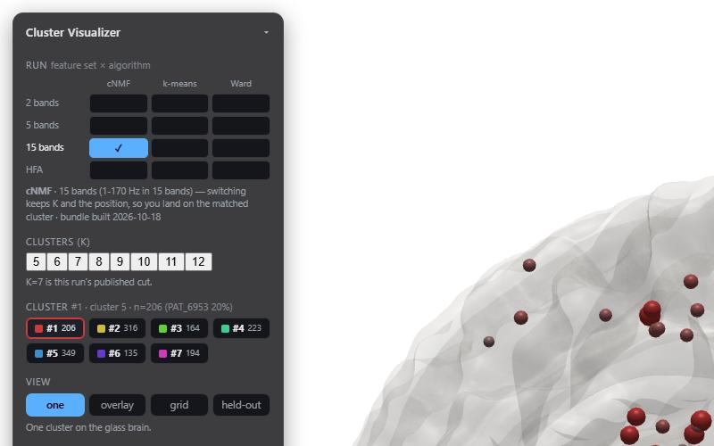

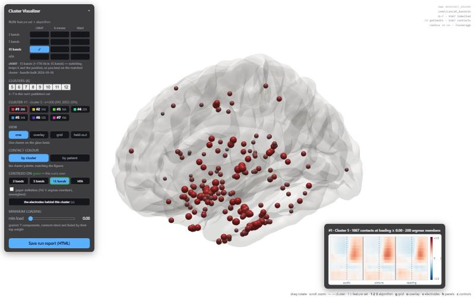

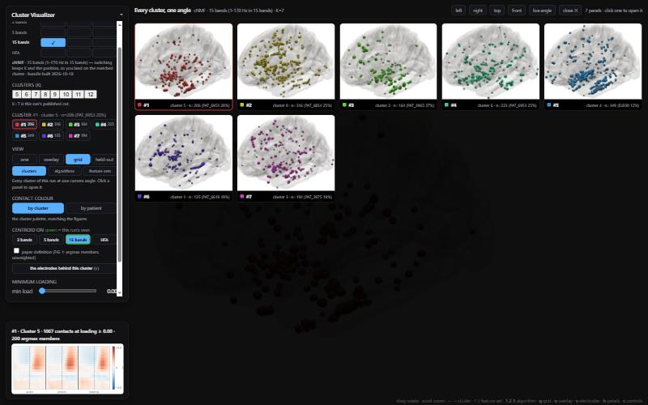

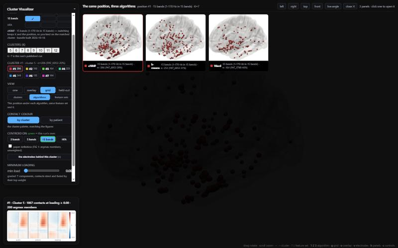

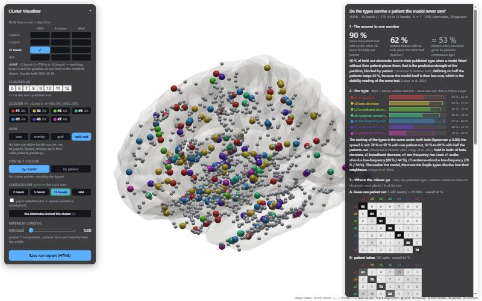

## Claim 1 · The clustering gives seven recurring response types, each carried by many patients

**Paper figure.** Fig 1, the types. Its seven blocks are the chips `#1 … #7`, in that order.

**Where to click.**

- **1.** `Run`: 15 bands × cNMF.
- **2.** `Clusters (K)`: 7.
- **3.** `View` one, chip `#1` (c5 production); then chip `#7` (c3 sentence-stimulus low-frequency).
- **4.** All seven at once: `View` overlay, then click every chip.

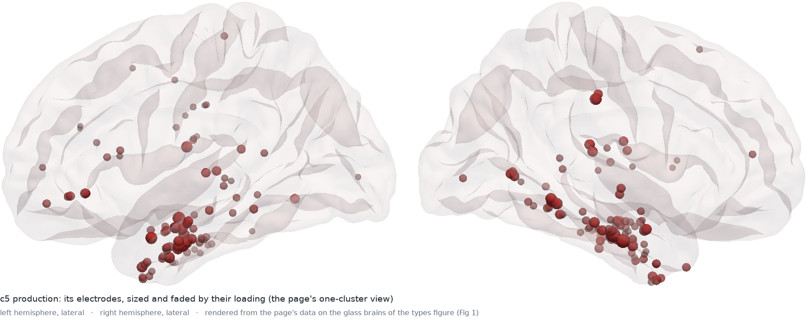

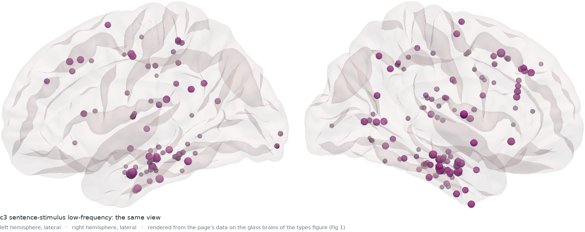

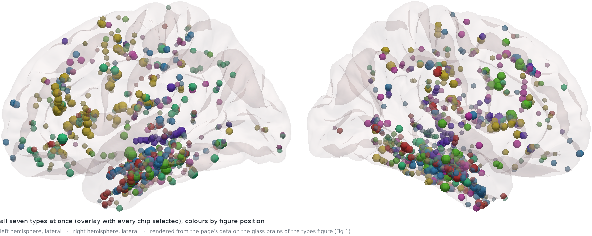

**What you see.** Every dot is one electrode of the type. Its size and its fade carry its loading on the type: small and grey below 0.5. The chip carries n and the biggest patient's share; the red `*` that marks a patient holding more than half of a cluster is absent at K 7.

**The numbers.**

| type | n | patients | largest patient's share |
|---|---|---|---|
| c5 production | 200 | 17 | 17 % |
| c0 beta decrease | 318 | 22 | 25 % |
| c2 broadband decrease | 168 | 11 | 36 % |
| c6 response-period low-frequency fall | 224 | 24 | 25 % |
| c4 low-frequency rise | 334 | 28 | 12 % |
| c1 audio-stimulus low-frequency | 143 | 22 | 20 % |
| c3 sentence-stimulus low-frequency | 200 | 25 | 18 % |

Median own-type loading 0.41; 16 % of the electrodes sit below the 0.3 draw cut (Ding et al. 2010).

**What it means.** Seven shapes, each spread over 11 to 28 patients. The mixed loadings are the first sign that the types are regions of a continuum rather than islands, which Claim 4 measures (Ding et al. 2010).

## Claim 2 · Other algorithms find the same shapes; the frequency description matters more than the algorithm

**Paper figure.** Fig 2, agreement: A and B the ARI and NMI matrices with the modal-agreement map, C the matched clusters against the two nulls, D the diagonal share.

**Where to click.**

- **1.** `View` grid, `algorithms`: chip `#1` under convex NMF, k-means and Ward at K 7. In k-means and Ward, position #1 is the cluster paired one-to-one with convex NMF's production cluster, by Hungarian assignment on the electrodes two clusters share (Kuhn 1955).
- **2.** `feature sets`: chip `#1` on 15, 5, 2 bands and HFA. Here every run's chips follow its own types figure (Fig 1, and S3 for the other three sets), so position #1 is each feature set's first block.
- **3.** Switch a run in `Run`: the position is kept and the run note prints the ARI against the run you came from.

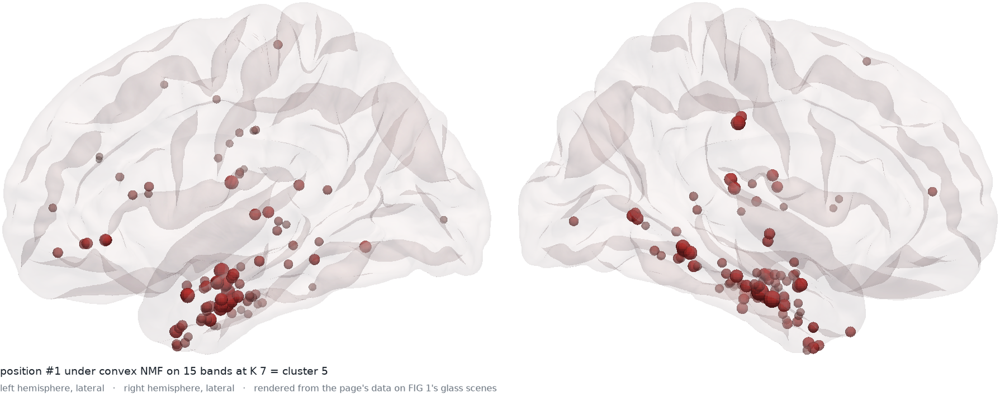

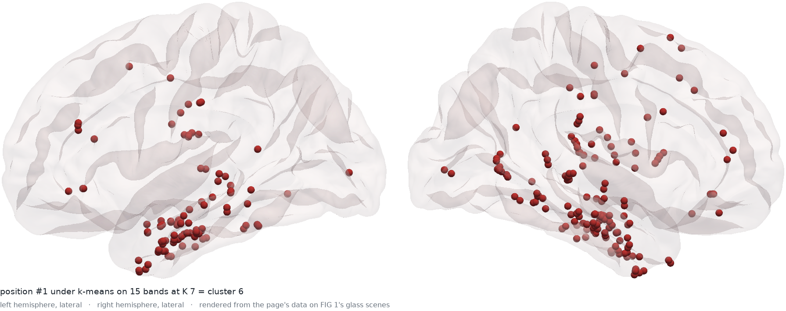

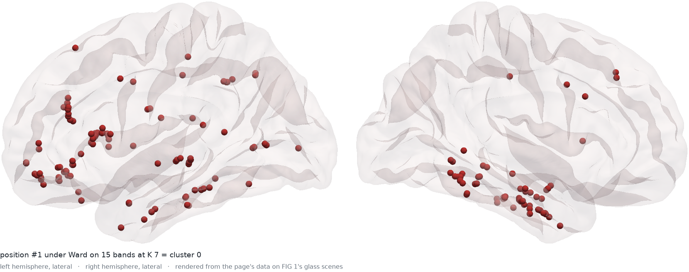

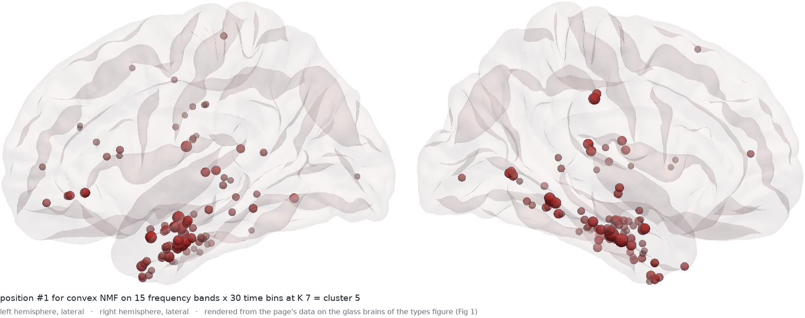

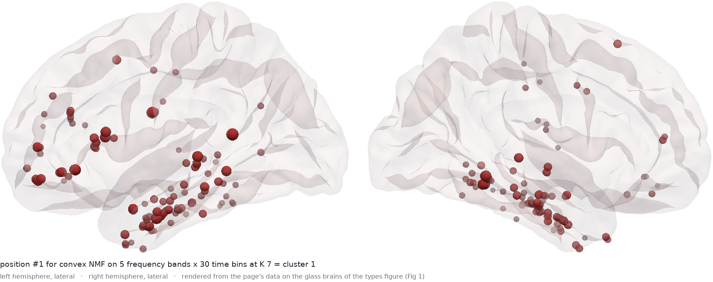

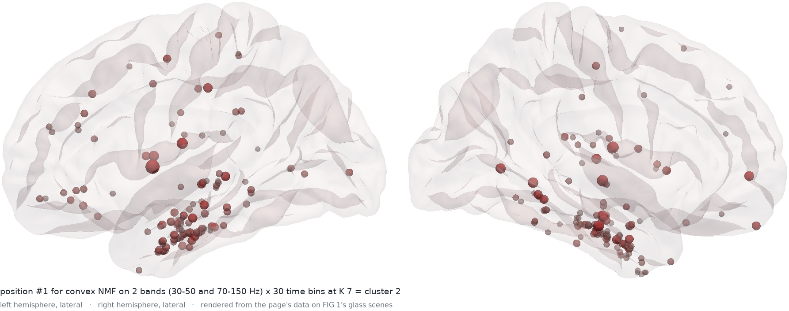

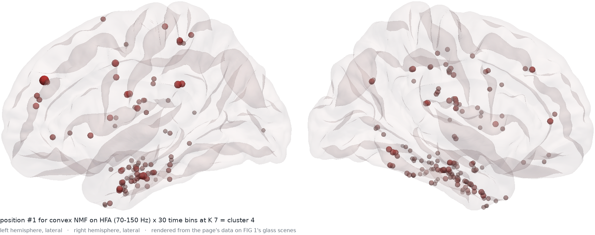

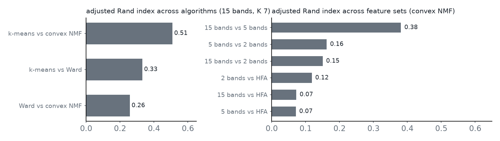

**What you see.** k-means puts the production type on much the same contacts as convex NMF; Ward's partner is a different set of contacts, and the Ward cluster that overlaps production most sits at another position. Across feature sets the first block is production-like each time, on about a third of the same contacts.

**The numbers.**

| comparison | ARI | contacts shared by position #1 (Jaccard with c5) |
|---|---|---|
| k-means vs convex NMF | 0.51 | 0.57 |
| k-means vs Ward | 0.33 | – |
| Ward vs convex NMF | 0.26 | 0.07 (c5's best-overlapping Ward cluster: 0.22, at position #4) |
| 15 bands vs 5 bands | 0.38 | 0.33 |
| 15 bands vs 2 bands | 0.15 | 0.36 |
| 15 bands vs HFA | 0.07 | 0.26 |
| 5 bands vs 2 bands | 0.16 | – |
| 5 bands vs HFA | 0.07 | – |
| 2 bands vs HFA | 0.12 | – |

All three algorithms agree on 47 % of the electrodes, all four feature sets on 11 % (Hubert & Arabie 1985).

**What it means.** Changing the algorithm moves the electrodes less than changing the frequency description (Hubert & Arabie 1985). Agreement is not correctness: four descriptions can agree on an artefact of the gate.

## Claim 3 · The shapes come back when patients are resampled, and K 7 is the last K before one patient owns a cluster

**Paper figure.** Fig 3, stability: A the one-patient clusters over K, B–D the consensus panels, E leave one patient out, F K 7 → 8.

**Where to click.**

- **1.** `Clusters (K)`: 8. One chip now carries the red `*` (a patient holds more than half of it); back at 7 it is gone.
- **2.** `View` held-out → section 4 · On the brain → colour by `consensus margin`.
- **3.** Source `patient halves`; section 5 · Is it patients? lists the patients, worst first.

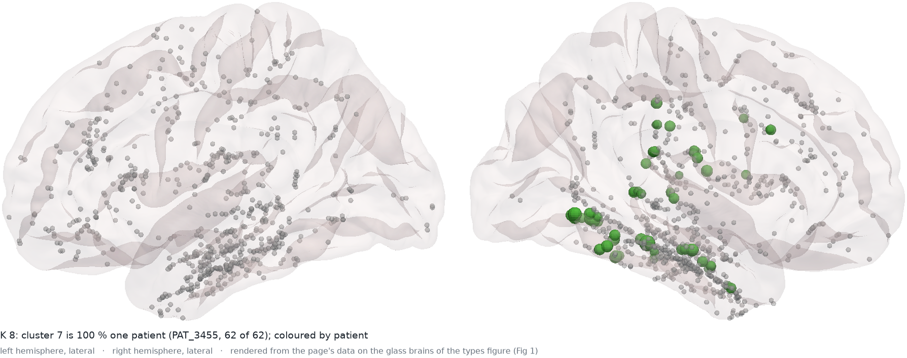

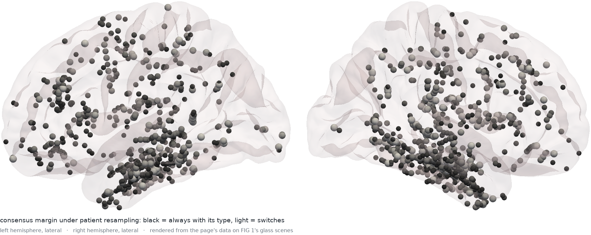

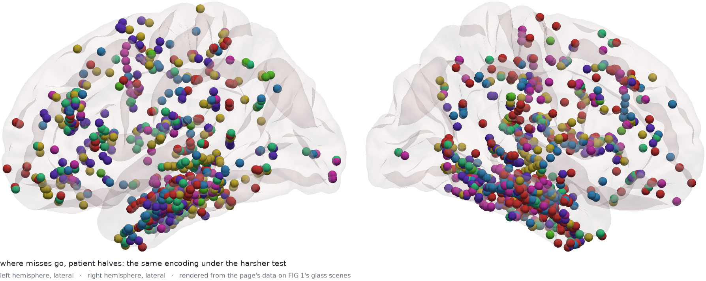

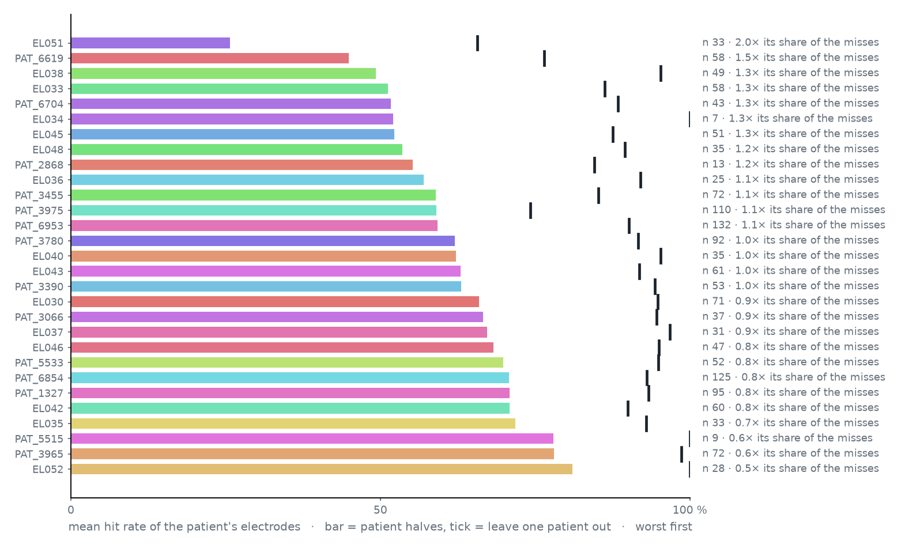

**What you see.** At K 8 the extra cluster is one patient's strip of contacts; at K 7 no cluster is more than half one patient. Under consensus margin the dark electrodes stay with their type when 20 % of the patients are dropped and the light ones switch. Under the halves test the misses concentrate in a few patients.

**The numbers.**

- K 8: cluster 7 is 100 % one patient (PAT_3455, 62 of 62). K 7: the largest share is 36 % (PAT_3965 in c2 broadband decrease).
- PAC 0.234 against 0.428 ± 0.031 for the Gaussian cloud (Monti et al. 2003; Şenbabaoğlu et al. 2014).
- The halves placement keeps 62 % overall; EL051 2.0×, PAT_6619 1.5×, EL038 1.3× carry more than their share of the misses; 1 of 29 patients keeps at least 80 % (Lange et al. 2004; Varoquaux et al. 2017).

| type | consensus (mean M within the type) |
|---|---|
| c4 low-frequency rise | 0.81 |
| c5 production | 0.78 |
| c2 broadband decrease | 0.78 |
| c6 response-period low-frequency fall | 0.71 |
| c0 beta decrease | 0.69 |
| c1 audio-stimulus low-frequency | 0.62 |
| c3 sentence-stimulus low-frequency | 0.53 |

Consensus is the share of resampling runs in which two electrodes land together (Monti et al. 2003).

**What it means.** The partition is stable against patients, and K 7 is where that stops. The cloud has no patient structure, so the dominance rule is the guard (Şenbabaoğlu et al. 2014).

## Claim 4 · The types are separable: an electrode from an unseen patient lands in its type nine times in ten, and the leaks run between neighbours

**Paper figure.** Fig 4, separation: B is this test (where held-out electrodes land), F its patient-halves version, G the per-electrode hit rate; A, C and D are the silhouette and MMD readings of the same question.

**Where to click.**

- **1.** `View` held-out, source `leave one patient out`, colour by `where misses go`. Section 1 gives the three numbers, section 2 the per-type bars.
- **2.** Section 3: click the cell `c3 → c4` in matrix B (patient halves). The brain lights the electrodes of that cell and steps the rest back.
- **3.** Section 4: colour by `hit rate`.

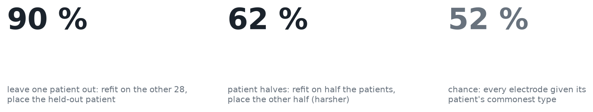

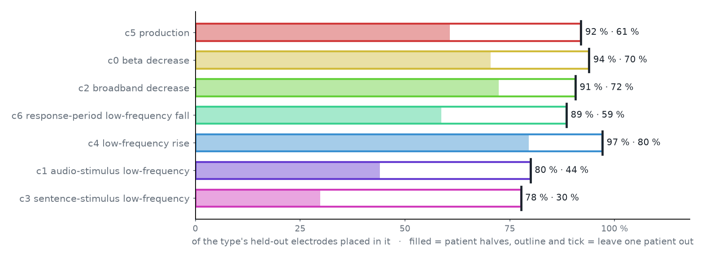

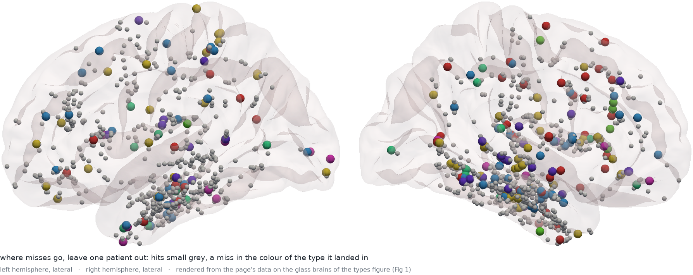

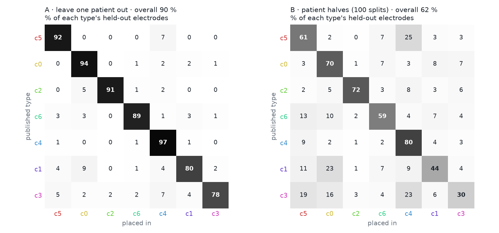

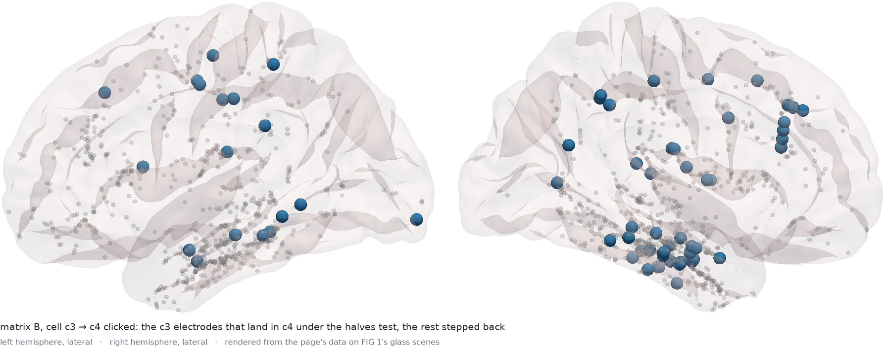

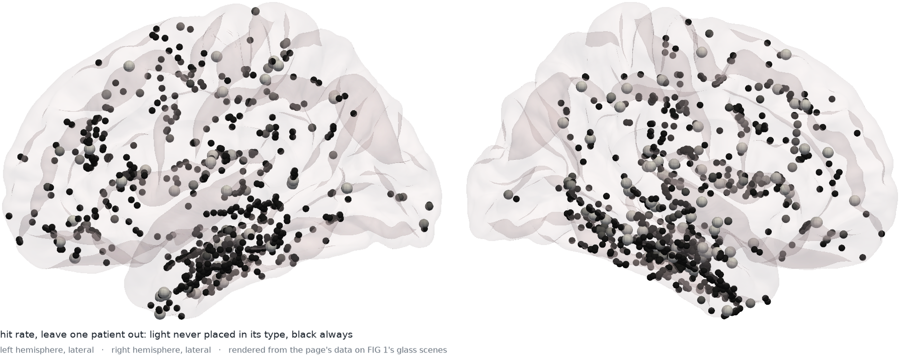

**What you see.** Most electrodes are small grey hits. The coloured dots are misses, painted in the colour of the type they were placed in; for c3 they are spread over both hemispheres and many patients, so the leak is neither one patient nor one place. The clicked cell shows exactly which c3 electrodes the halves test puts in c4.

**The numbers.**

90 % of held-out electrodes land in their published type with one patient out, 62 % with half the patients out, chance about 52 % (Tibshirani & Walther 2005; Lange et al. 2004).

| type | leave one patient out | patient halves | loses most to (one out) | loses most to (halves) |
|---|---|---|---|---|
| c4 low-frequency rise | 97 % | 80 % | c1 (1 %) | c5 (9 %) |
| c0 beta decrease | 94 % | 70 % | c4 (2 %) | c1 (8 %) |
| c5 production | 92 % | 61 % | c4 (7 %) | c4 (25 %) |
| c2 broadband decrease | 91 % | 72 % | c0 (5 %) | c4 (8 %) |
| c6 response-period low-frequency fall | 89 % | 59 % | c0 (3 %) | c5 (13 %) |
| c1 audio-stimulus low-frequency | 80 % | 44 % | c0 (9 %) | c0 (23 %) |
| c3 sentence-stimulus low-frequency | 78 % | 30 % | c4 (7 %) | c4 (23 %) |

Per electrode, 1354 of 1587 land in their type in every fold and 104 never do; the refit clusters are aligned to the published ones by Hungarian assignment before counting (Tibshirani & Walther 2005; Kuhn 1955).

**What it means.** Separable in the sense that matters, an unseen electrode can be told apart, and only partly: the leaky types lose a fifth of their electrodes to their neighbours, which is what a continuum of responses looks like under a partition (Tibshirani & Walther 2005).

## Claim 4 on every feature set and algorithm · the separation tables of the MMD run

**Paper figure.** Fig 4 C and D (the held-out MMD against the Gaussian cloud) and S5; the placement test of Claim 4 (Fig 4 B) is run on every cell the same way.

**Where to click.** `Run`: pick the cell in the matrix, then `View` held-out. A run whose tables are published shows the panel; the others say that none are published yet. The cells below are the MMD run's own tables on disk, which is where the page's numbers come from.

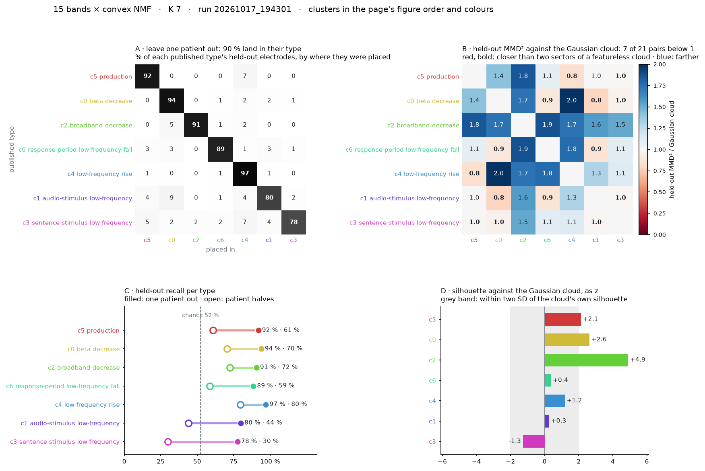

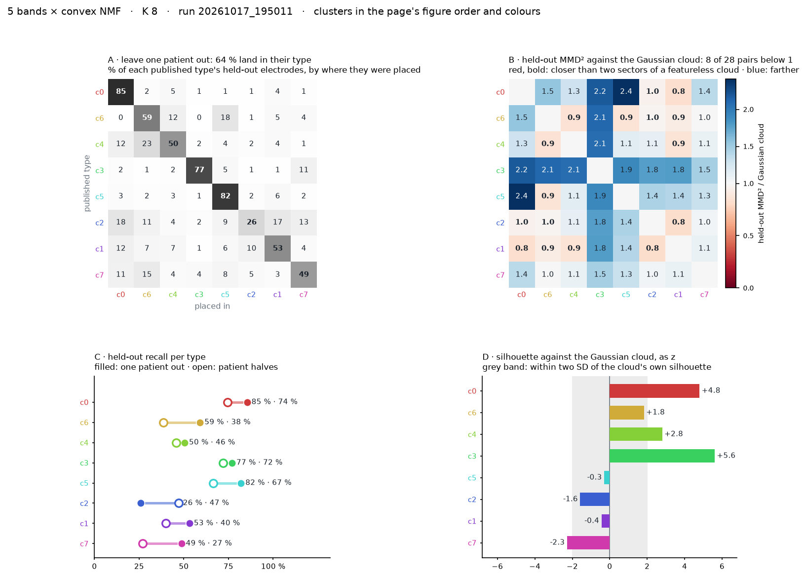

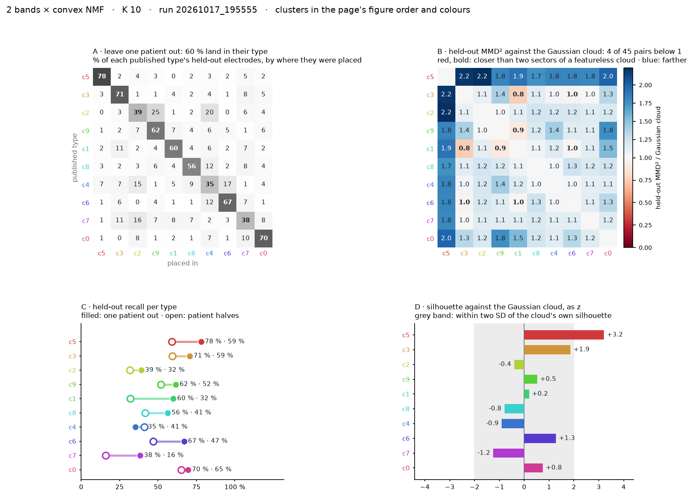

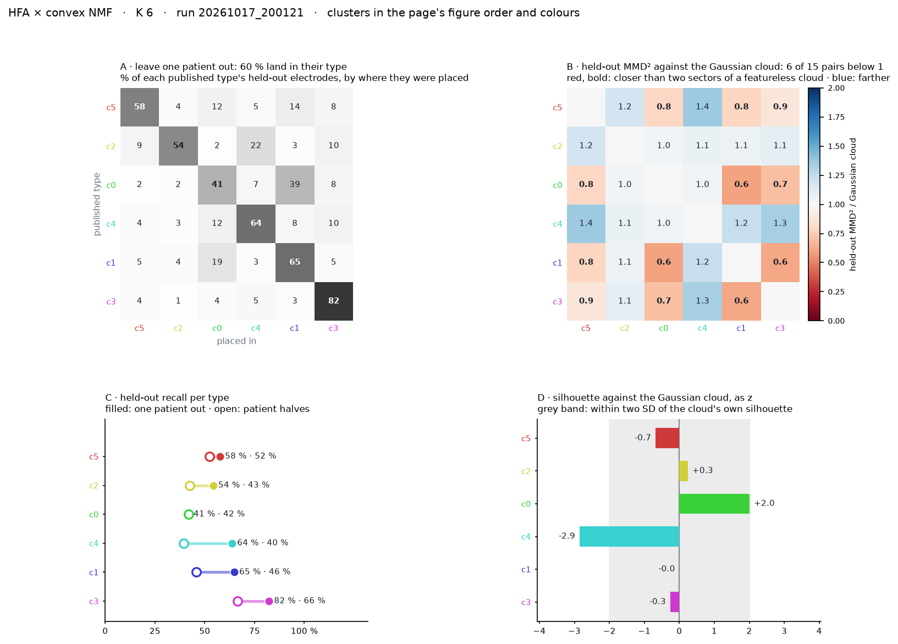

**What you see.** One figure per feature set, convex NMF, clusters in the page's order and colours: A the leave-one-patient-out confusion, B every pair's held-out MMD² as a ratio to the cloud (red and bold below 1: the pair is closer than two sectors of a featureless Gaussian), C each type's held-out recall under both tests, D its silhouette z against the cloud (the grey band is the cloud's own spread). k-means and Ward have the same tables; the summary below carries every cell.

**The numbers.**

| feature set | algorithm | K | one patient out | patient halves | weakest type | closest pair · MMD² · ratio to cloud | pairs below the cloud | silhouette z, lowest … highest |
|---|---|---|---|---|---|---|---|---|
| 15 bands | convex NMF | 7 | 90 % | 62 % | c3 (78 %) | c0–c1 · 0.097 · 0.79 | 7 of 21 | c3 -1.3 … c2 +4.9 |
| 15 bands | k-means | 7 | 83 % | 63 % | c4 (50 %) | c3–c4 · 0.091 · 0.62 | 10 of 21 | c4 -0.9 … c2 +2.6 |
| 15 bands | Ward | 7 | 50 % | 45 % | c3 (0 %) | c1–c2 · 0.082 · 0.57 | 8 of 21 | c6 -1.6 … c1 +2.5 |
| 5 bands | convex NMF | 8 | 64 % | 54 % | c2 (26 %) | c1–c2 · 0.117 · 0.82 | 8 of 28 | c7 -2.3 … c3 +5.6 |
| 5 bands | k-means | 8 | 76 % | 57 % | c2 (0 %) | c0–c7 · 0.092 · 0.46 | 15 of 28 | c6 -2.4 … c2 +5.8 |
| 5 bands | Ward | 8 | 57 % | 47 % | c1 (1 %) | c6–c7 · 0.102 · 0.52 | 11 of 28 | c7 -1.5 … c2 +4.6 |
| 2 bands | convex NMF | 10 | 60 % | 48 % | c4 (35 %) | c1–c3 · 0.100 · 0.76 | 4 of 45 | c7 -1.2 … c5 +3.2 |
| 2 bands | k-means | 10 | 76 % | 59 % | c8 (51 %) | c1–c3 · 0.093 · 0.45 | 26 of 45 | c0 -2.6 … c5 +3.0 |
| 2 bands | Ward | 10 | 52 % | 45 % | c2 (0 %) | c0–c5 · 0.098 · 0.48 | 23 of 45 | c7 -2.1 … c1 +3.3 |
| HFA | convex NMF | 6 | 60 % | 49 % | c0 (41 %) | c0–c1 · 0.144 · 0.60 | 6 of 15 | c4 -2.9 … c0 +2.0 |
| HFA | k-means | 6 | 74 % | 64 % | c0 (42 %) | c2–c5 · 0.127 · 0.41 | 8 of 15 | c1 -2.1 … c5 +1.9 |
| HFA | Ward | 6 | 62 % | 57 % | c1 (17 %) | c4–c5 · 0.128 · 0.41 | 10 of 15 | c2 -1.5 … c0 +1.6 |
| 15 bands z | convex NMF | 7 | not run yet | | | | | |
| 15 bands z | k-means | 7 | not run yet | | | | | |
| 15 bands shape | convex NMF | 7 | not run yet | | | | | |
| 15 bands shape | k-means | 7 | not run yet | | | | | |
| 15 bands ternary | convex NMF | 7 | not run yet | | | | | |
| 15 bands ternary | k-means | 7 | not run yet | | | | | |

Leave-one-patient-out placement runs from 50 % (15 bands × Ward) to 90 % (15 bands × convex NMF); the patient-halves test is harsher everywhere (Tibshirani & Walther 2005; Lange et al. 2004). Pairs below the cloud, convex NMF: 15 bands 7 of 21, 5 bands 8 of 28, 2 bands 4 of 45, HFA 6 of 15 (Gretton et al. 2012). The bandwidth, the cloud and the shuffles are those of the MMD run (n_perm 5000, splits 100) (Gretton et al. 2012; Rousseeuw 1987).

The variant cells are listed as not run yet: on the server, `python 00_paper2_figure6_mmd.py --sets concat_bands15z concat_bands15s --methods cnmf kmeans` (the main cell's settings: `--n-perm 5000 --n-perm-heldout 500 --n-splits 100 --n-cloud 100`), then `python make_heldout_bundle.py --write` and this report again.

**What it means.** The separation reading is the same in every description: most held-out electrodes land in their type, and the pairs that sit below the cloud are the neighbours of a continuum, not distinct islands (Tibshirani & Walther 2005; Gretton et al. 2012). K differs between sets (the one-patient rule picks it per set), so the pair counts are read within a set, not across.

## Claim 5 · The scorecard: c2 and c4 solid, c1 and c3 fragile, c5 solid under patients but weak across methods

**Paper figure.** Fig 5, the scorecard.

**Where to click.**

- **1.** In the held-out view click the type bar `c3` in section 2, then `c2`: the brain keeps that type's electrodes only.
- **2.** Section 5: click the worst patient.

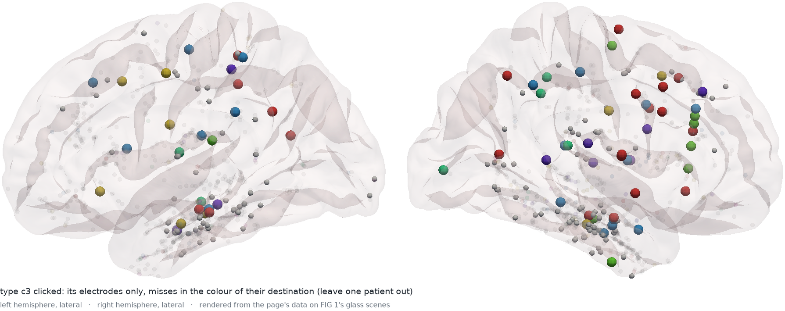

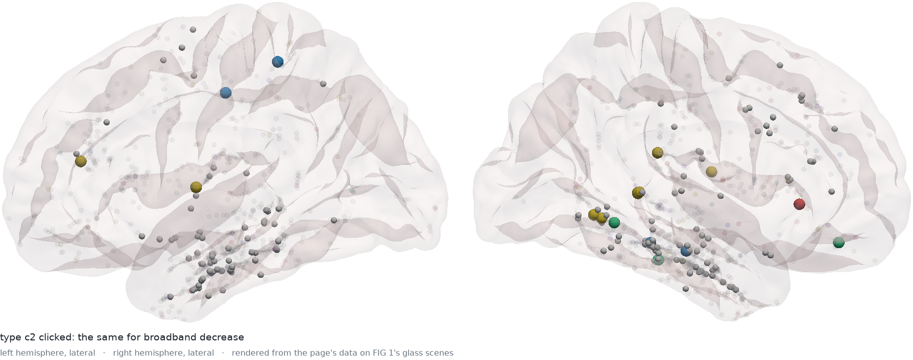

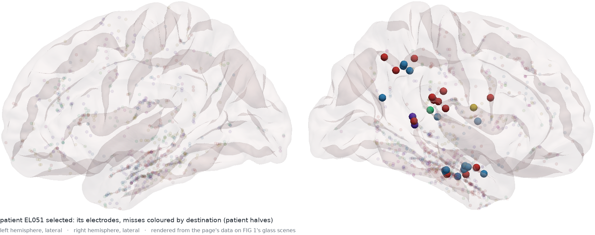

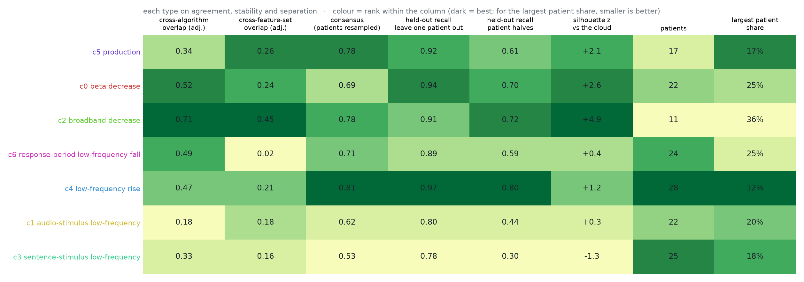

**What you see.** c3's electrodes are spread over both hemispheres (77 left, 123 right; 57 % in temporal cortex against 65 % for the whole cohort) and a fifth of them are coloured as misses. c2's are 75 % temporal (72 left, 96 right) with almost none coloured.

**The numbers.** The scorecard's columns, one row per type:

| type | overlap across algorithms | overlap across feature sets | consensus | one patient out | patient halves | silhouette z | patients | largest share |
|---|---|---|---|---|---|---|---|---|
| c5 production | 0.34 | 0.26 | 0.78 | 92 % | 61 % | +2.1 | 17 | 17 % |
| c0 beta decrease | 0.52 | 0.24 | 0.69 | 94 % | 70 % | +2.6 | 22 | 25 % |
| c2 broadband decrease | 0.71 | 0.45 | 0.78 | 91 % | 72 % | +4.9 | 11 | 36 % |
| c6 response-period low-frequency fall | 0.49 | 0.02 | 0.71 | 89 % | 59 % | +0.4 | 24 | 25 % |
| c4 low-frequency rise | 0.47 | 0.21 | 0.81 | 97 % | 80 % | +1.2 | 28 | 12 % |
| c1 audio-stimulus low-frequency | 0.18 | 0.18 | 0.62 | 80 % | 44 % | +0.3 | 22 | 20 % |
| c3 sentence-stimulus low-frequency | 0.33 | 0.16 | 0.53 | 78 % | 30 % | -1.3 | 25 | 18 % |

Overlaps are chance-adjusted Jaccards of matched clusters (Hubert & Arabie 1985; Kuhn 1955); consensus as in Claim 3 (Monti et al. 2003); the held-out columns as in Claim 4 (Tibshirani & Walther 2005); silhouette z is the type's silhouette against the Gaussian cloud (Rousseeuw 1987).

**What it means.** Each type is rated on all three questions; the colour of a scorecard cell is its rank in the column, not a composite score.

## Two things to know when reading the page

- The page opens at K 8 (its default); every claim above is read at K 7, the paper's cut. The held-out view switches to K 7 by itself.
- At K 7 the page's chips count the published fit's labels (c5 206, c2 164, c4 349 …) while the paper's figures and the held-out view use the sweep fit's partition (c5 200, c2 168, c4 334 …); the two agree on 95.7 % of the electrodes.

## References

- Tibshirani R, Walther G (2005). Cluster validation by prediction strength. Journal of Computational and Graphical Statistics 14(3): 511–528.
- Lange T, Roth V, Braun ML, Buhmann JM (2004). Stability-based validation of clustering solutions. Neural Computation 16(6): 1299–1323.
- Varoquaux G, Raamana PR, Engemann DA, Hoyos-Idrobo A, Schwartz Y, Thirion B (2017). Assessing and tuning brain decoders: cross-validation, caveats, and guidelines. NeuroImage 145: 166–179.
- Kuhn HW (1955). The Hungarian method for the assignment problem. Naval Research Logistics Quarterly 2: 83–97.
- Ding C, Li T, Jordan MI (2010). Convex and semi-nonnegative matrix factorizations. IEEE Transactions on Pattern Analysis and Machine Intelligence 32(1): 45–55.
- Hubert L, Arabie P (1985). Comparing partitions. Journal of Classification 2: 193–218.
- Monti S, Tamayo P, Mesirov J, Golub T (2003). Consensus clustering: a resampling-based method for class discovery and visualization of gene expression microarray data. Machine Learning 52: 91–118.
- Şenbabaoğlu Y, Michailidis G, Li JZ (2014). Critical limitations of consensus clustering in class discovery. Scientific Reports 4: 6207.
- Gretton A, Borgwardt KM, Rasch MJ, Schölkopf B, Smola A (2012). A kernel two-sample test. Journal of Machine Learning Research 13: 723–773.
- Rousseeuw PJ (1987). Silhouettes: a graphical aid to the interpretation and validation of cluster analysis. Journal of Computational and Applied Mathematics 20: 53–65.
- Owen AB, Perry PO (2009). Bi-cross-validation of the SVD and the nonnegative matrix factorization. Annals of Applied Statistics 3(2): 564–594.
